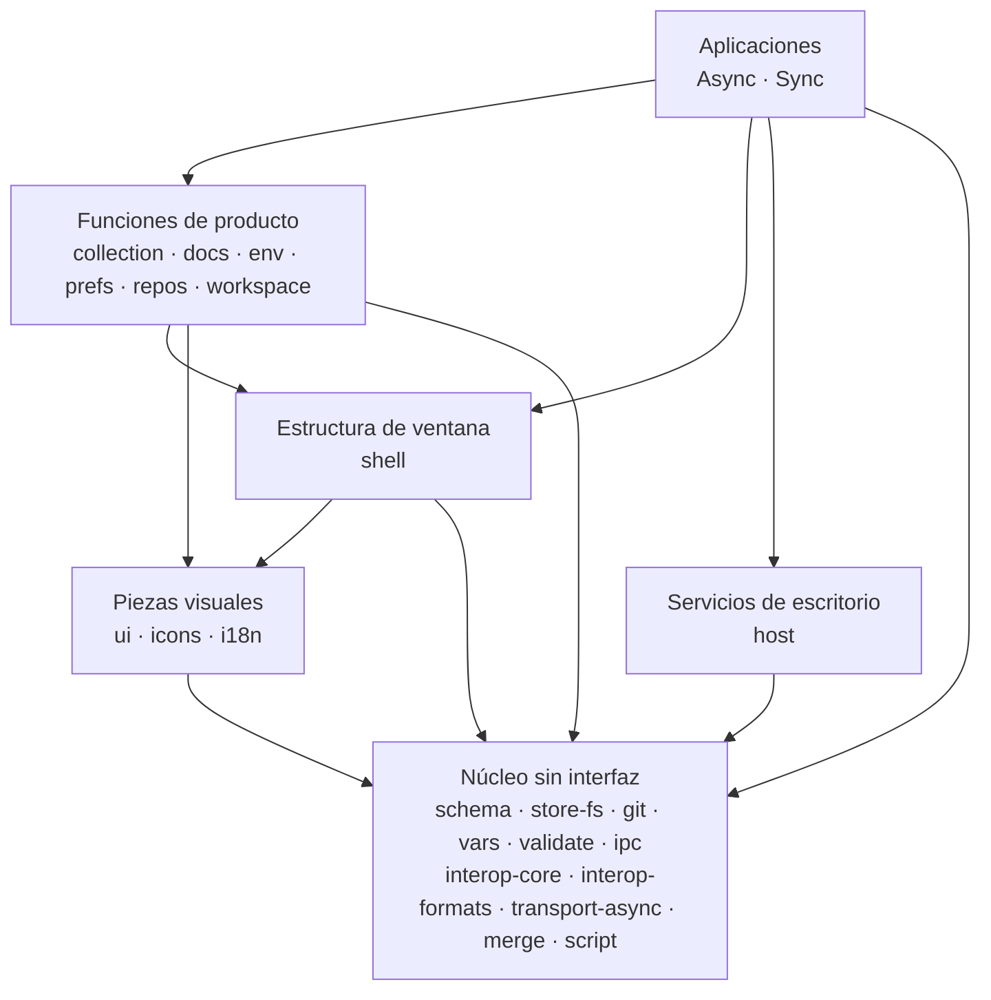
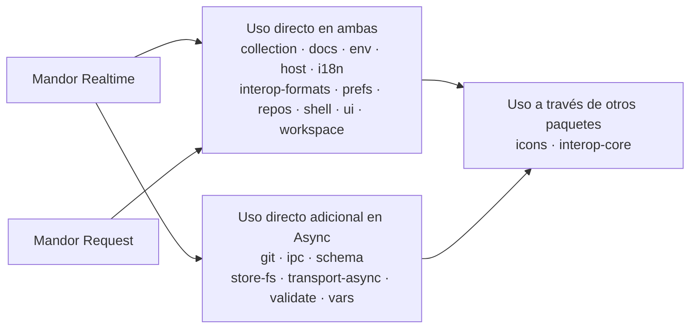

# Paquetes de Mandor

Esta carpeta contiene las bibliotecas que comparten las aplicaciones. Cada paquete tiene una
responsabilidad propia y una API pública en `src/index.ts`. La aplicación decide cómo combinar esas
piezas; el paquete no necesita saber si lo usa Async o Sync.

Un _workspace_ es un proyecto del usuario. En Electron, `main` administra ventana, disco y red;
`renderer` dibuja la interfaz; `preload` expone al renderer las operaciones permitidas.

## Mapa general

Las líneas indican la dirección permitida de las dependencias, no que todos los paquetes de una
caja importen todos los de la siguiente. Los `package.json` muestran las dependencias exactas.
`host` presta servicios al proceso principal y al preload; los paquetes visuales se montan en el
renderer. El puente `preload` de cada aplicación conecta ambos lados mediante los contratos de `ipc`.

## Qué aporta cada paquete

| Capa       | Paquete                                        | Responsabilidad                                                   |
| ---------- | ---------------------------------------------- | ----------------------------------------------------------------- |
| Núcleo     | [`schema`](schema/README.md)                   | Tipos, esquemas e identificadores del modelo guardado.            |
| Núcleo     | [`store-fs`](store-fs/README.md)               | Lectura y escritura del modelo en archivos locales.               |
| Núcleo     | [`git`](git/README.md)                         | Estado y commits del repositorio local.                           |
| Núcleo     | [`vars`](vars/README.md)                       | Resolución de referencias `{{variable}}`.                         |
| Núcleo     | [`merge`](merge/README.md)                     | Fusión de tres versiones de un valor o de un archivo.             |
| Núcleo     | [`validate`](validate/README.md)               | Validación de valores frente a JSON Schema.                       |
| Núcleo     | [`ipc`](ipc/README.md)                         | Contratos tipados de comunicación entre renderer, preload y main. |
| Núcleo     | [`interop-core`](interop-core/README.md)       | Modelo intermedio y plan común para importar recursos externos.   |
| Núcleo     | [`interop-formats`](interop-formats/README.md) | Los formatos de intercambio: OpenAPI, AsyncAPI, Postman y HAR.    |
| Núcleo     | [`transport-async`](transport-async/README.md) | Conexiones WebSocket y Socket.IO, mensajes y reconexión.          |
| Núcleo     | [`script`](script/README.md)                   | `@mandor/script`: motor QuickJS de los scripts, con sus topes.    |
| Plataforma | [`host`](host/README.md)                       | Servicios comunes del proceso principal de Electron.              |
| Visual     | [`icons`](icons/README.md)                     | Glifos compartidos y generación de componentes de icono.          |
| Visual     | [`i18n`](i18n/README.md)                       | Idiomas y textos compartidos.                                     |
| Visual     | [`ui`](ui/README.md)                           | Controles, editor y estilos base.                                 |
| Visual     | [`shell`](shell/README.md)                     | Rejilla, pestañas, navegación y registros de superficies.         |
| Función    | [`collection`](collection/README.md)           | Navegación y edición de las colecciones del workspace.            |
| Función    | [`docs`](docs/README.md)                       | Lectura y edición de documentos del workspace.                    |
| Función    | [`env`](env/README.md)                         | Entornos y variables editables.                                   |
| Función    | [`prefs`](prefs/README.md)                     | Preferencias de la interfaz.                                      |
| Función    | [`repos`](repos/README.md)                     | Gestión de orígenes locales y conectados.                         |
| Función    | [`workspace`](workspace/README.md)             | Selección y gestión de workspaces.                                |

## Relación actual con las aplicaciones

Este diagrama resume **dependencias directas declaradas** por `apps/*/package.json`. Describe cómo
las aplicaciones componen hoy los paquetes; no restringe los futuros consumidores de cada biblioteca.

Sync compone hoy la base compartida. La diferencia entre aplicaciones se decide en `apps/async` y
`apps/sync`, no con ramas por tipo de aplicación dentro de una biblioteca.

### Dependencias exactas entre paquetes

Esta tabla lee `dependencies` de cada `packages/*/package.json` y `devDependencies` de las dos
apps, que bundlean todo paquete del repo. “Directa” significa que la app declara el paquete en su
manifiesto; un paquete también puede llegar a ella por dependencia de otro.

| Paquete           | Depende de paquetes del repo                                                  | App con dependencia directa |
| ----------------- | ----------------------------------------------------------------------------- | --------------------------- |
| `collection`      | i18n, icons, ipc, schema, shell, ui                                           | Async, Sync                 |
| `docs`            | i18n, icons, ipc, schema, shell, ui                                           | Async, Sync                 |
| `env`             | i18n, icons, ipc, schema, shell, ui, vars                                     | Async, Sync                 |
| `git`             | Ninguno                                                                       | Async                       |
| `host`            | git, i18n, interop-core, ipc, merge, schema, script, store-fs, validate, vars | Async, Sync                 |
| `i18n`            | ipc                                                                           | Async, Sync                 |
| `icons`           | Ninguno                                                                       | Por otros paquetes          |
| `interop-core`    | schema                                                                        | Por otros paquetes          |
| `interop-formats` | interop-core, schema                                                          | Async, Sync                 |
| `ipc`             | interop-core, schema                                                          | Async                       |
| `merge`           | Ninguno                                                                       | host                        |
| `prefs`           | i18n, ipc, schema, shell, ui                                                  | Async, Sync                 |
| `repos`           | i18n, icons, ipc, schema, shell, ui                                           | Async, Sync                 |
| `schema`          | Ninguno                                                                       | Async                       |
| `script`          | schema                                                                        | host                        |
| `shell`           | i18n, icons, ipc, schema, ui                                                  | Async, Sync                 |
| `store-fs`        | schema                                                                        | Async                       |
| `transport-async` | Ninguno                                                                       | Async                       |
| `ui`              | icons, validate                                                               | Async, Sync                 |
| `validate`        | Ninguno                                                                       | Async                       |
| `vars`            | Ninguno                                                                       | Async                       |
| `workspace`       | i18n, icons, ipc, schema, shell, ui                                           | Async, Sync                 |

## Cómo seguir una función

1. Abre el README del paquete que describe la responsabilidad buscada. Es el resumen y el índice.
2. Sigue el README del paquete: empieza por su arquitectura, recorre un uso concreto y consulta la
   API pública. Los paquetes con ciclos largos también incluyen una sección de flujos.
3. Revisa `src/index.ts` y las subrutas de `exports` en `package.json`: son las entradas públicas.
   Sigue el módulo de implementación indicado y su prueba en `tests/`.
4. Si buscas el cableado, revisa `apps/<app>/src/main/`, `preload/` o `renderer/`. Main usa
   servicios de escritorio; preload expone el puente; renderer compone la interfaz.

Una importación interna de otro paquete que no pase por su `exports` rompe esa frontera. Los
paquetes se consumen desde `src/`; las aplicaciones los empaquetan al construir sus ejecutables.
