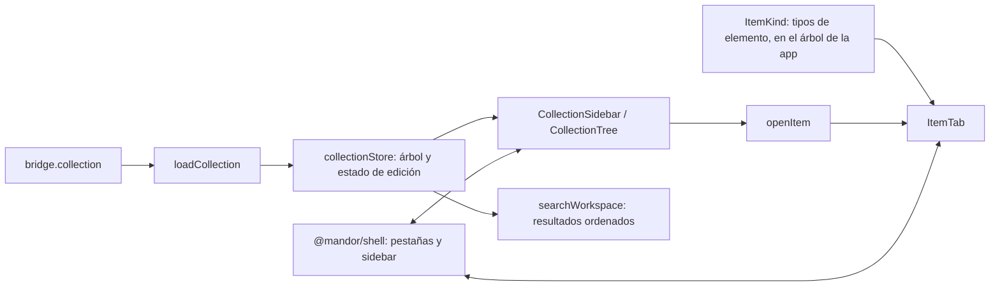

# `@mandor/collections`

Muestra y modifica las **colecciones** de un espacio de trabajo: carpetas y elementos ordenados en un árbol. Guarda en memoria el árbol leído, selección, carpetas plegadas y ediciones abiertas. También ofrece búsqueda sobre los elementos del espacio. La aplicación registra qué tipos de elemento sabe dibujar; el paquete trabaja con esas declaraciones sin importar sus implementaciones.

## Arquitectura

No hay una jerarquía de clases. Este es el recorrido de los datos:

### Cómo se extiende

Cada elemento del árbol tiene un `itemKind`. La app declara cada tipo en su árbol con `<ItemKind kind component newLabel>`; puede añadir `open(resource)` si debe atender la apertura antes que la pestaña. Lo que se ve va como hijos: `<ItemBody>` (la pestaña), `<ItemMark>` (la marca que sustituye al glifo en la fila y en la pestaña, como el método de una petición) e `<ItemStatus>` (la ranura final de la pestaña). Cada parte lee su elemento con `useItem()`: `resource` y `saved`, la marca que el árbol leyó del archivo. `<ItemTabKind />` declara una sola clase de pestaña para todos los tipos de elemento. Al desmontar un tipo, el paquete deja de ofrecerlo sin requerir una condición por aplicación.

La búsqueda combina elementos propios con `WorkspaceEntries` entregadas por `sources`. `searchWorkspace` es una función pura: primero prioriza coincidencias en nombre, luego ruta y después etiquetas. `openSearchHit` interpreta la URI; los entornos usan el callback y los recursos con pestaña usan el registro del shell. La interfaz lateral solo muestra el árbol almacenado: `WorkspaceCollection` y las operaciones de escritura vuelven a leerlo cuando corresponde.

## Uso y cambios

### Mostrar una colección

1. Monta `WorkspaceCollection` en el árbol React del espacio activo. Este componente solicita el árbol cuando cambia el espacio; `CollectionSidebar` presenta el estado ya cargado.
2. Monta la sección lateral con `<CollectionsSection order={…} />` y la pestaña común `<ItemTabKind />` en el árbol de la app.
3. Monta en el mismo árbol un `<ItemKind>` por tipo de elemento. El paquete usa esa declaración para el icono, el nombre de creación y el contenido de la pestaña. El paquete que conoce el tipo aporta su vista.

[`src/collection-store.ts`](src/collection-store.ts) conserva árbol, selección y edición; [`src/lib/`](src/lib/) contiene las operaciones que aplanan y localizan nodos. Si necesitas una vista propia, empieza por [`src/components/`](src/components/) y evita duplicar el árbol en otro store.

### Abrir o buscar un elemento

`openItem(workspaceId, path)` forma una URI de recurso y enfoca o abre la pestaña. `ItemTab` dibuja el `ItemBody` del tipo. Para incorporar resultados de otros paquetes, pasa sus fuentes a `<WorkspaceSearch sources={…} />`; el buscador ordena coincidencias de nombre, ruta y etiquetas, y `openSearchHit` dirige la apertura.

Una modificación de la forma del árbol exige revisar juntos el contrato en `@mandor/schema`, la lectura por el bridge y [`tests/`](tests/). Una modificación solo visual puede empezar por el componente correspondiente y su prueba.

### Recorrido de una edición

Al crear una carpeta o un elemento, [`createCollectionNode`](src/lib/create-collection-node.ts) envía el nombre y la carpeta padre al bridge. El proceso principal convierte el nombre en el segmento de disco. Si la respuesta es correcta, `loadCollection` vuelve a leer el árbol; si falla, el store conserva un código de error para mostrarlo en la interfaz.

El renombre elige `renameFolder` o `renameItem` según el nodo. [`renameCollectionNode`](src/lib/rename-collection-node.ts) mueve las pestañas que apuntan al nodo o a sus descendientes y luego recarga el árbol. El movimiento y el borrado siguen la misma idea: el bridge cambia datos y el paquete reconcilia selección y pestañas. Para seguir estas reglas, lee [`src/lib/`](src/lib/) junto a las pruebas de [`tests/`](tests/).

## API pública

| Exportación                                                                   | Uso                                                                                                                                           |
| ----------------------------------------------------------------------------- | --------------------------------------------------------------------------------------------------------------------------------------------- |
| `collectionStore`                                                             | Store compartido: nodos, selección, carpetas plegadas, borrador, renombrado, borrado pendiente y error.                                       |
| `loadCollection(workspaceId)`                                                 | Lee el árbol mediante el bridge y reemplaza los nodos del store. Conserva solo rutas seleccionadas que sigan presentes.                       |
| `nodeAt(nodes, path)`                                                         | Encuentra un nodo por ruta; una ruta que aún no llegó es «todavía no», nunca un fallo.                                                        |
| `itemResource(origin, workspaceId, path)`, `itemPartsOf(resource)`            | Construyen e interpretan la URI de recurso de un elemento.                                                                                    |
| `ItemKind`, `ItemBody`, `ItemMark`, `ItemStatus`, `useItem()`, `ItemProvider` | Declaran en el árbol cómo dibujar, nombrar y crear un tipo de elemento. Cada parte lee su elemento con `useItem()`.                           |
| `itemLeaf(kind)`                                                              | Lo declarado para un tipo, o nada.                                                                                                            |
| `useItemFromDisk`                                                             | Mantiene un elemento al paso de su archivo: lo lee la primera vez, avisa de un fallo y relee cuando el archivo cambia en disco.               |
| `ItemTabKind`, `ItemTab`                                                      | La pestaña común de elementos: su declaración y su cuerpo. Un tipo no declarado es una página que lo dice.                                    |
| `CollectionSidebar`, `WorkspaceCollection`, `CollectionsSection`              | Lista lateral, cargador por espacio que también habla de los fallos de escritura, y declaración de la sección con el orden de la app.         |
| `CollectionsSectionAction`, `CollectionRowAction`, `useCollectionRow()`       | Declaran un botón en la cabecera de la sección o una línea del menú de las filas de un tipo; la línea lee su fila con `useCollectionRow()`.   |
| `WorkspaceSearch`                                                             | Declara el buscador lateral mientras está montado. `sources` agrega entradas de otras features; `openEnvironment` abre resultados de entorno. |

Ejemplo: `<ItemKind kind="mi-tipo" component={FileIcon} newLabel="items:new"><ItemBody><MiPanel /></ItemBody></ItemKind>`; `MiPanel` lee `useItem().resource`. Desmontarlo retira el tipo.
