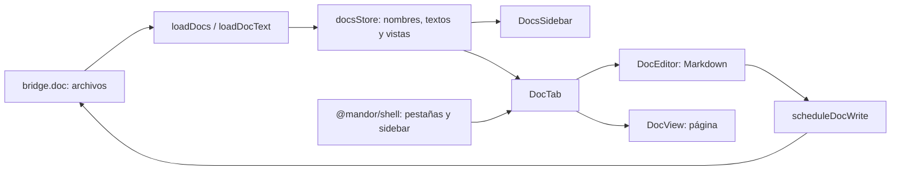

# `@mandor/docs`

Lee, crea y edita documentos Markdown de un espacio de trabajo. Ofrece una lista lateral, pestañas de lectura y edición, y la misma superficie de visor y editor para la descripción de un elemento, así que un doc del espacio y una descripción se leen y se escriben igual en las dos apps. Usa `@mandor/shell` para pestañas y el bridge de `@mandor/ipc` para archivos.

## Arquitectura

No hay clases principales: componentes React, funciones de archivo y un store de Zustand cooperan mediante una URI de recurso. La URI identifica el documento; el ID de pestaña identifica cómo se muestra.



`docsStore` guarda nombres de archivos, textos por recurso, lecturas en curso y vista por pestaña. Dos vistas del mismo archivo comparten texto; cada pestaña conserva su modo (`read` o `write`), vista previa, ajuste de líneas y tamaño. `beginRead` evita pedir dos veces el mismo texto simultáneamente. Al cerrar una pestaña se libera su vista y posición de lectura, mientras el texto permanece en el store.

`WorkspaceDocs` observa el espacio activo y la sección lateral. Carga la lista al cambiar de espacio y al desplegar la sección; `DocsSidebar` solo la dibuja. `openDoc` enfoca una pestaña existente para el recurso o abre una nueva. Un documento vacío se abre en el editor; uno con contenido, como página. `DocTab` fija esa elección al cargar el texto, para que escribir el primer carácter no cambie la vista. Las ediciones se muestran de inmediato desde el store y la escritura a disco se programa con una pausa breve.

`DocView` recibe texto Markdown y un callback opcional para enlaces a recursos. No lee stores ni pestañas. Procesa Markdown con GFM, filtra el árbol HTML, controla las URL, colorea bloques de código y dibuja los bloques `mermaid`; un diagrama a medio escribir deja el último que salió, con el error debajo. `DocEditor` también recibe su texto y `onChange`; `modelKey` permite compartir modelo y deshacer entre vistas del mismo recurso. `DocWrite` puede dibujar editor y vista previa lado a lado, con desplazamiento sincronizado.

Usa `@mandor/ui` para controles y editor, `@mandor/icons` para acciones, `@mandor/i18n` para textos, `@mandor/schema` y `@mandor/ipc` para identidades y contratos, y `@mandor/shell` para pestañas y barra lateral.

Archivos clave: [`src/docs-store.ts`](src/docs-store.ts), [`src/doc-view-state.ts`](src/doc-view-state.ts), [`src/components/workspace/WorkspaceDocs.tsx`](src/components/workspace/WorkspaceDocs.tsx), [`src/components/tab/DocTab.tsx`](src/components/tab/DocTab.tsx), [`src/components/view/DocView.tsx`](src/components/view/DocView.tsx) y [`src/lib/`](src/lib/). Las pruebas de `tests/` cubren apertura, edición, enlaces, vistas, desplazamiento y renderizado.

## Uso y cambios

### Integrar documentos en una ventana

Monta la sección con `<DocsSection order={…} />` y los dos tipos de pestaña con `<DocTabKind />` y `<DocPreviewTabKind />`. Monta `WorkspaceDocs` para cargar la lista del espacio activo. Cada declaración vive mientras su elemento está montado. `DocsSidebar` solo presenta la lista, mientras `openDoc` enfoca una pestaña existente o crea otra.

Para incrustar Markdown sin administrar archivos, usa `DocView` con `value` y, si hay enlaces internos, `onOpenResource`. Para la descripción de un elemento, usa `DocDescription` con `value`, `onChange`, `modelKey` (el elemento, no el panel: abierto dos veces es un texto y un deshacer) y `label`. Estas dos son las superficies reutilizables; las pestañas añaden lectura, guardado y estado de sesión.

### Recorrido de una edición

[`DocTab`](src/components/tab/DocTab.tsx) obtiene el texto y conserva el modo por pestaña. [`scheduleDocWrite`](src/lib/pending-doc-write.ts) actualiza ese texto en `docsStore` antes de escribir el archivo. Espera 400 ms desde la última pulsación y mantiene el temporizador fuera del componente, de modo que cerrar la pestaña no descarta una edición pendiente. `cancelDocWrite` retira ese temporizador antes de revertir un documento. Si el bridge rechaza la escritura, el callback recibe el código de error.

La URI identifica el archivo y permite compartir texto entre vistas; el ID de pestaña identifica su modo y posición. Al renombrar, [`renameDoc`](src/lib/rename-doc.ts) cambia las URIs abiertas para que sigan apuntando al archivo. Este recorrido une store, pestañas y disco sin poner la escritura dentro de `DocEditor`.

Para cambiar el renderizado de Markdown, comienza en [`DocView`](src/components/view/DocView.tsx); para cambiar persistencia o carga, sigue [`docsStore`](src/docs-store.ts) y [`src/lib/`](src/lib/). Las pruebas en [`tests/`](tests/) separan ambos recorridos.

## API pública

Se importa desde `@mandor/docs`; la hoja de estilo de la página se importa desde `@mandor/docs/prose.css`.

| Exportación                       | Contrato y uso                                                                                                      |
| --------------------------------- | ------------------------------------------------------------------------------------------------------------------- |
| `WorkspaceDocs`, `DocsSection`    | Cargador sin interfaz y declaración de la sección lateral mientras está montada.                                    |
| `DocTabKind`, `DocPreviewTabKind` | Declaran en el árbol las pestañas de documento y de vista previa.                                                   |
| `DocCommands`                     | Componente sin interfaz que declara los comandos de documentos dentro del árbol React, donde vive el aviso.         |
| `workspaceDocEntries`             | Convierte los documentos del store en entradas para la búsqueda del espacio.                                        |
| `DocView`                         | Página Markdown reutilizable. Recibe `value` y, opcionalmente, `onOpenResource` y `onTask`; no administra archivos. |
| `DocDescription`                  | Visor y editor de la descripción de un elemento, con el mismo Markdown que un doc.                                  |

Ejemplo de superficie embebida:

```tsx
import { DocView } from '@mandor/docs';

function Preview({ markdown }: { markdown: string }) {
    return <DocView value={markdown} />;
}
```

Para integrar la lista y las pestañas, monta `WorkspaceDocs`, registra la sección y los dos tipos de pestaña durante la vida de la ventana, y ejecuta las funciones de limpieza al desmontar. El consumidor decide orden lateral y cómo tratar enlaces externos al documento.
