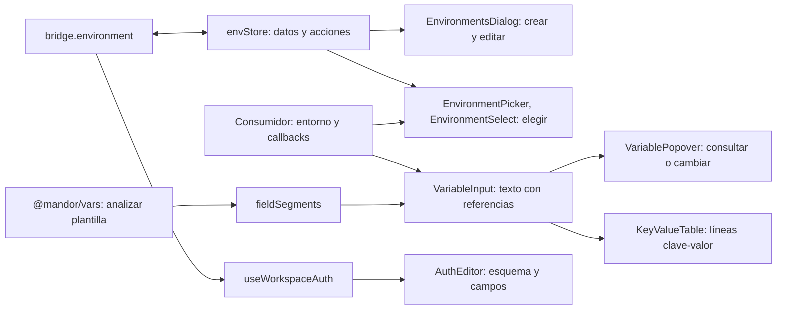

# `@mandor/env`

Gestiona **entornos** de un espacio de trabajo y ayuda a escribir referencias de variables como `{{nombre}}` en campos de texto. Un entorno reúne variables, sus valores y la indicación de cuáles son secretos. El paquete ofrece store, selector, diálogo de gestión, campo con sugerencias, la tabla clave-valor que usan parámetros, cabeceras, campos de cuerpo y variables, y el editor de autenticación de cualquier nivel. El consumidor entrega el entorno activo y decide dónde guardar los cambios de un campo; el paquete no necesita conocer esa decisión.

## Arquitectura

No usa clases como centro de diseño. Funciones, componentes y un store separan los datos de su presentación:

`envStore` guarda la lista leída, los IDs activos por espacio y el último error. Sus acciones llaman a `bridge.environment` y recargan la lista tras una escritura correcta.

`EnvironmentsDialog` conserva localmente la selección y un borrador. Valida y programa la escritura cuando cambia el detalle. `VariableInput` recibe texto, entorno y callbacks: resalta referencias mediante `@mandor/vars`, ofrece nombres mientras se escribe y abre `VariablePopover` sobre una referencia. El consumidor recibe `onVariablesChange` para guardar cambios hechos desde ese panel. La búsqueda recibe solo nombres de variables, nunca sus valores. `useEditorVariables` da lo mismo a un editor de código: tonos por variable y el panel para leerla o crearla.

`KeyValueTable` es la tabla de pares de las dos apps: líneas con clave, valor y si se envían, columnas opcionales, filas que la app añade sola (`KeyValueAutoLine`) y grupos con nombre (`KeyValuePreset`). `keyValueLinesOf` y `requestLinesOf` traducen entre las líneas de una petición y las de la tabla; una línea a medio escribir se queda en pantalla y el archivo recibe solo las que tienen nombre. `KEY_HEADER_NAMES` son las cabeceras del estándar que sugiere la celda de clave.

`AuthEditor` edita la autenticación de cualquier nivel en una columna: tipo, qué hace con la petición, sus campos. `WorkspaceAuthAction` y `WorkspaceVariablesAction` son las puertas del panel de espacios a la autenticación y a las variables que todo lo de abajo hereda; las dos apps las registran. `useWorkspaceAuth` lee y escribe la del espacio por el bridge y, si main rechaza, vuelve al valor anterior.

Archivos clave: [`src/env-store.ts`](src/env-store.ts), [`src/components/dialog/EnvironmentsDialog.tsx`](src/components/dialog/EnvironmentsDialog.tsx), [`src/components/field/VariableInput.tsx`](src/components/field/VariableInput.tsx) y [`src/lib/field-segments.ts`](src/lib/field-segments.ts).

## Uso y cambios

### Elegir y administrar un entorno

`useEnvironments()` lee la lista del espacio activo. `EnvironmentPicker` recibe esa lista, el valor elegido y `onChange`: el consumidor conserva la elección. Si debe ofrecer edición completa, monta `ManagedEnvironments` y abre el diálogo mediante `openManagedEnvironments(workspaceId, environmentId)`. [`envStore`](src/env-store.ts) coordina llamadas a `bridge.environment`, estado de carga y errores.

### Escribir una referencia

`AddressField` recibe el texto y el entorno que debe mostrar. Reconoce `{{nombre}}`, ofrece coincidencias y llama los callbacks del consumidor cuando cambia el texto o una variable. [`fieldSegments`](src/lib/field-segments.ts) prepara los fragmentos visuales; la resolución efectiva de la plantilla pertenece a `@mandor/vars`. Los nombres pueden entrar en la búsqueda del espacio mediante `workspaceEnvironmentEntries`; los valores secretos no se indexan como texto.

Para cambiar cómo se guardan entornos, sigue [`env.slice.ts`](src/env.slice.ts) y el contrato `environment` de `@mandor/ipc`. Para cambiar sugerencias, sigue [`src/components/field/`](src/components/field/) y [`src/lib/`](src/lib/). [`tests/`](tests/) cubre store, selección, edición y sugerencias por separado.

### Cuándo llega un cambio al disco

El diálogo mantiene un borrador mientras se escribe. [`scheduleValidEnvironmentWrite`](src/lib/pending-environment-write.ts) programa guardar tras 400 ms de pausa solo si todos los nombres de variables cumplen `variableNameSchema`; una fila vacía del todo no bloquea y no llega al archivo. Un nombre aún incompleto queda visible en pantalla, pero no reemplaza la última versión válida del entorno en disco. El temporizador vive fuera del diálogo para sobrevivir a su cierre.

## API pública

| Exportación                                                                              | Uso                                                                                                                                                                                                                  |
| ---------------------------------------------------------------------------------------- | -------------------------------------------------------------------------------------------------------------------------------------------------------------------------------------------------------------------- |
| `envStore`                                                                               | El store de entornos de la ventana. Sus acciones cargan, crean, actualizan, borran y seleccionan entornos; `error` guarda el último fallo.                                                                           |
| `useEnvironments()`                                                                      | Carga los entornos del espacio activo y devuelve su lista para React.                                                                                                                                                |
| `EnvironmentPicker`                                                                      | Muestra las opciones recibidas. Recibe `value`, `options` y `onChange`; el propietario de la elección controla el valor.                                                                                             |
| `EnvironmentSelect`, `ManageEnvironmentsButton`                                          | `EnvironmentSelect` solo elige, como primera parte de un `AddressBar`; sin opciones sigue en su sitio y dice de dónde salen. `ManageEnvironmentsButton` abre el diálogo del espacio activo desde la barra de título. |
| `EnvironmentsDialog`, `ManagedEnvironments`                                              | Diálogo de lista y detalle; `ManagedEnvironments` lo monta una vez por ventana desde el estado global de apertura.                                                                                                   |
| `openManagedEnvironments(workspaceId, environmentId)`                                    | Abre el diálogo desde cualquier sitio (barra de título, paleta, panel lateral).                                                                                                                                      |
| `AddressField`                                                                           | La dirección de un `AddressBar` en las dos apps: campo con variables, sin caja propia, que ocupa el sitio libre.                                                                                                     |
| `useEditorVariables({ environment, onVariablesChange })`                                 | Las variables de un editor de código: lo que lee el editor y el panel para leer, editar o crear una.                                                                                                                 |
| `KeyValueTable`, `KeyValueLine`, `KeyValueColumns`, `KeyValueAutoLine`, `KeyValuePreset` | Tabla de pares y los tipos de sus líneas, columnas, filas automáticas y grupos.                                                                                                                                      |
| `keyValueLinesOf(lines)`, `requestLinesOf(lines)`, `KEY_HEADER_NAMES`                    | De líneas de petición a líneas de tabla y vuelta; cabeceras estándar que sugiere la clave.                                                                                                                           |
| `EntryLine`, `EntryLineRow`, `withNewLine(lines)`                                        | Una línea encendida o apagada, su fila, y la lista con una línea nueva de identidad propia.                                                                                                                          |
| `AuthEditor`                                                                             | Editor de autenticación de cualquier nivel.                                                                                                                                                                          |
| `WorkspaceAuthAction`, `WorkspaceVariablesAction`, `useWorkspaceAuth(workspaceId)`       | Puertas del panel de espacios a su autenticación y sus variables; lectura y escritura de la autenticación del espacio.                                                                                               |
| `workspaceEnvironmentEntries`                                                            | Aporta entornos y nombres de variables a la búsqueda del espacio. Nunca incluye valores.                                                                                                                             |

Ejemplo: `await envStore.getState().load(workspaceId);`. El store habla con main por el bridge del renderer, que cumple el contrato `CoreBridge` de `@mandor/ipc`.
