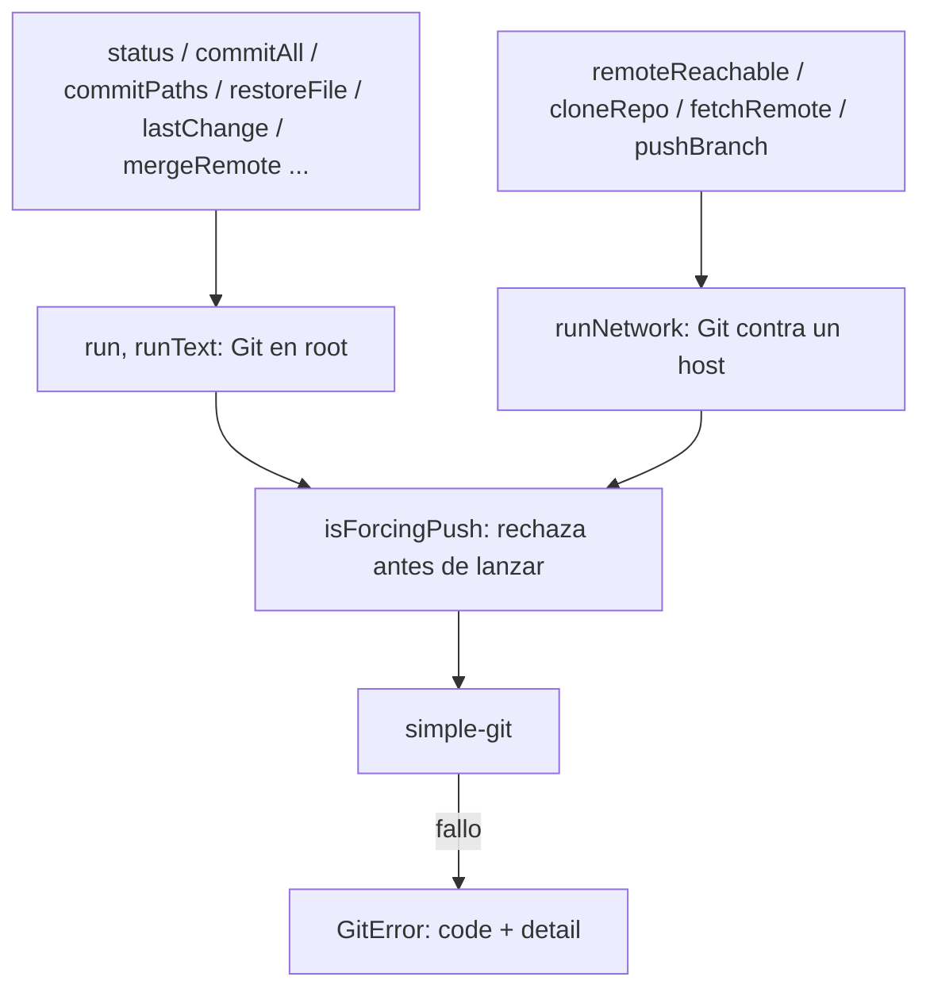

# @mandor/git

Opera Git sobre el repositorio de datos de un origen: lo prepara, lee su estado, guarda cambios, deshace un archivo y sincroniza con el remoto (traer, unir, avanzar y enviar). Las operaciones locales reciben la raíz; las de red reciben además un `NetworkAccess`. Todo fallo llega como `GitError`.

## Arquitectura

Todas las funciones públicas pasan por un único ejecutor, [`src/git/run.ts`](src/git/run.ts): es el único sitio del repositorio que lanza Git.



Lo que el ejecutor garantiza en cada llamada:

- **Ningún push reescribe el origen.** `isForcingPush` reconoce `--force`, `--mirror`, `--delete`, `--prune`, sus abreviaturas, `-f`, `-d` y los refspec con `+` o `:`, y la llamada se rechaza antes de lanzar Git.
- **Ningún checkout crea un enlace.** `core.symlinks=false` va en toda llamada: un repo ajeno no puede apuntar un doc o un entorno a otro archivo de la máquina.
- **La red no se cuelga.** Las llamadas de red tienen un tope de 60 s, y el token viaja aparte de la URL: la URL se guarda, se registra y se muestra; el token no.
- **Todo fallo tiene código.** `GitError.code` es lo que decide la interfaz; `detail` lleva la salida cruda de Git solo para el log, así que ninguna ruta o remoto del usuario llega a la pantalla.

Las escrituras de un mismo repo (`commitAll`, `commitPaths`, `restoreFile`, `concludeMerge`) toman el lock del índice de Git, que rechaza a un segundo escritor: quien llama las ejecuta de una en una.

El paquete depende de `simple-git` y de ningún otro paquete del monorepo. [`src/git/`](src/git/) tiene el ejecutor, el acceso de red y el error; [`src/repo/`](src/repo/), una operación por archivo. Las pruebas usan un repo real en disco y, como remoto, un repo bare local: `npm run ci:test -- packages/git`.

## Uso y cambios

### Operar un repositorio de datos

`initRepo(root)` deja `root` como repo con la higiene que Mandor necesita; uno que ya existe se adopta, nunca se reinicia. `status(root)` muestra cambios sin escribir. `commitPaths(root, paths, message)` guarda solo lo que tocó una escritura, y `commitAll` todo lo pendiente; ninguno crea un commit vacío. `lastChange(root, path)` dice cuándo cambió un archivo y `restoreFile(root, path)` lo devuelve al último commit.

```ts
import { status } from '@mandor/git';

async function showChanges(root: string) {
    const current = await status(root);

    if (!current.clean) {
        console.log(current.unstaged);
    }
}
```

### Sincronizar con el origen

`fetchRemote` trae lo del origen sin tocar el trabajo. `aheadBehind` cuenta lo que tiene cada lado. Si solo avanzó el origen, `fastForward` mueve la rama. Si avanzaron los dos, `mergeRemote` deja la unión abierta: `stageTexts` da los tres textos de cada choque, y quien llama cierra con `concludeMerge` o vuelve atrás con `abortMerge`. `pushBranch` envía la rama con su nombre; un origen que avanzó desde el último fetch lo rechaza el propio origen.

### Añadir una operación

Va en [`src/repo/`](src/repo/), un archivo por operación, y se publica desde [`src/index.ts`](src/index.ts) si otro paquete la llama. Llama a `run`, `runText` o `runNetwork`, nunca a `simple-git`. Si acepta una ruta, la pasa después de `--` para que Git no la lea como opción. Se prueba con nombres con espacios o guiones, con un repo sin cambios y con el código de error.

## API pública

| Exportación                                                | Cuándo usarla                                                                         |
| ---------------------------------------------------------- | ------------------------------------------------------------------------------------- |
| `initRepo`, `hasCommits`, `nameFirstBranch`                | Preparar o adoptar un repo; saber si la rama tiene commits y nombrar la primera.      |
| `status`                                                   | Lo pendiente, con rutas relativas a la raíz y barras `/`.                             |
| `commitPaths`, `commitAll`, `commitMessage`, `RepoChange`  | Guardar lo que tocó una escritura, o todo; el mensaje sale del cambio, siempre igual. |
| `lastChange`, `restoreFile`                                | Fecha del último commit de una ruta; devolver un archivo a ese commit.                |
| `cloneRepo`, `remoteReachable`, `NetworkAccess`            | Traer un repo entero; preguntar si una URL responde; qué presenta una llamada de red. |
| `fetchRemote`, `aheadBehind`, `fastForward`, `pushBranch`  | Traer, comparar, avanzar y enviar la rama.                                            |
| `mergeRemote`, `stageTexts`, `concludeMerge`, `abortMerge` | Unir con el origen dejando los choques abiertos, leerlos, cerrar o deshacer la unión. |
| `GitError`                                                 | El fallo clasificado: `code` para decidir, `detail` para el log.                      |
