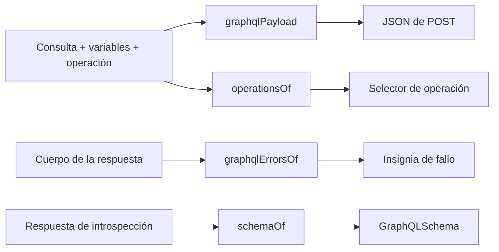

# `@mandor/graphql`

Lo puro de GraphQL que Sync necesita: arma el JSON que se manda por HTTP, lista las operaciones de un documento, lee los `errors` de una respuesta y construye un esquema desde una introspección. No abre sockets ni archivos: solo transforma datos que recibe.

## Arquitectura

- `request/` — `graphqlPayload`. Las variables son texto JSON con comentarios y comas finales, como las deja escribir el editor. Una suscripción, una sintaxis rota o unas variables que no son un objeto lanzan `GraphqlPayloadError`: nada de eso sale de la máquina.
- `document/` — `operationsOf`. Un error de sintaxis es una respuesta (`ok: false`), no una excepción: el editor sigue vivo con la consulta a medias.
- `response/` — `graphqlErrorsOf`. Un `200` con `errors` es un fallo; el cuerpo lo dice, el estado no.
- `introspection/` — `INTROSPECTION_QUERY` y `schemaOf`. Lo que publica un servidor no es de fiar: una respuesta mal formada es un mensaje.
