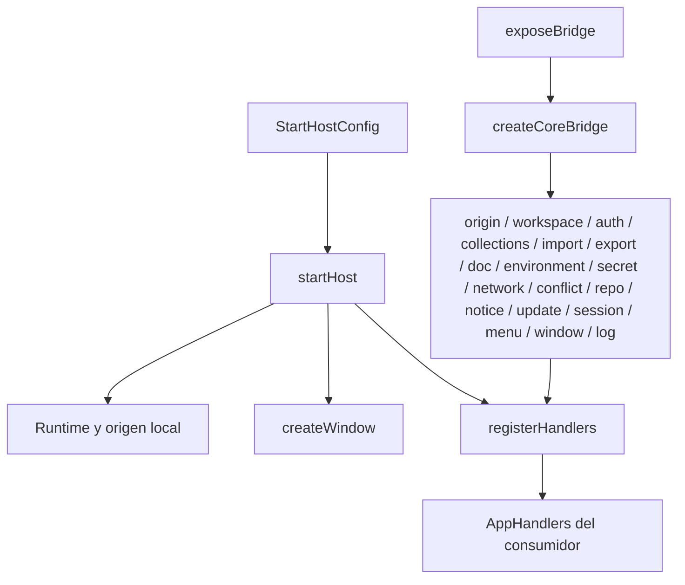
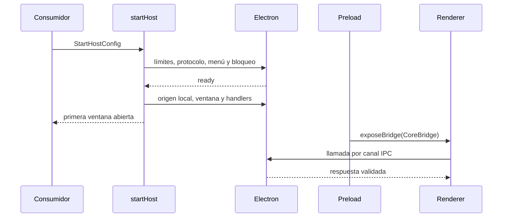

# `@mandor/host`

Base compartida del proceso principal de Electron y del _preload_ (script que prepara el puente seguro). Arranca la ventana, registra servicios comunes y expone funciones limitadas al _renderer_ (interfaz). Cada consumidor entrega identidad visual, tipo de espacio de trabajo, formatos y handlers propios mediante parámetros.

## Arquitectura

El host está organizado por servicios, no por app. [`runtime/`](src/runtime/) inicia Electron y registra handlers; [`window/`](src/window/) crea y protege la ventana; [`preload/`](src/preload/) arma el puente; [`ipc/`](src/ipc/) adapta llamadas y respuestas. Las demás carpetas implementan áreas comunes: origen, espacio, colecciones, documentos, importación, exportación, entornos, autenticación, secretos, red, choques, sincronización, actualizaciones, avisos, sesión, menú y registro.



`startHost` recibe `StartHostConfig`: `appId`, `title`, icono opcional, `kind`, `homepage`, `productName`, `mainDir`, y lo que solo esa app trae: `handlers`, `formats` y `stores`. Antes del primer `await` fija los límites de Chromium, el esquema del renderer y el menú, porque Electron los lee mientras arranca; después pide el bloqueo de instancia única, espera `app.whenReady()`, prepara el origen local, abre la ventana y registra el IPC. El paquete no importa código de una app.

`createWindow` configura `contextIsolation`, `sandbox` y `webSecurity`, y desactiva Node en la interfaz. Aplica Content Security Policy (CSP) con un nonce por ejecución, bloquea navegación fuera de la entrada y controla apertura de enlaces. El preload llama `createCoreBridge` para exponer las áreas de `CoreBridge`, un archivo de [`preload/bridges/`](src/preload/bridges/) por área; `exposeBridge` publica solo ese objeto en `window.mandor`. Los handlers validan las solicitudes recibidas por comunicación entre procesos (IPC); el puente valida las respuestas.

`registerHandlers` instala handlers comunes y después los de `AppHandlers`. Sus dependencias llegan en `HandlerDeps`, con interfaces pequeñas para IPC y ventana que permiten pruebas sin arrancar Electron. `redactedIpc` oculta secretos en respuestas. [`testing/handler-harness.ts`](src/testing/handler-harness.ts) contiene dobles públicos para probar handlers externos.

No hay una jerarquía de clases para entender este paquete: sus piezas principales son funciones y contratos. Sus clases propias son errores con nombre (`OriginForeignError`, `ConflictOpenError`…), que [`failureOf`](src/ipc/failure-of.ts) traduce a un código para el renderer.

Depende de `@mandor/ipc`, `@mandor/schema`, `@mandor/store-fs`, `@mandor/git`, `@mandor/merge`, `@mandor/interop-core`, `@mandor/vars` y `@mandor/i18n`; de fuera, `zod`, `oauth4webapi` para los flujos de token y `electron-updater`. Usa Electron en el proceso que lo monta; el renderer recibe solo el puente.

Rutas recomendadas: [`runtime/start-host.ts`](src/runtime/start-host.ts), [`runtime/register-handlers.ts`](src/runtime/register-handlers.ts), [`window/create-window.ts`](src/window/create-window.ts), [`preload/create-bridge.ts`](src/preload/create-bridge.ts) y [`preload/expose-bridge.ts`](src/preload/expose-bridge.ts).

## Uso y cambios

### Preparar una app Electron

El proceso principal llama `startHost(config)` con identidad, rutas y handlers propios, y entrega a `failToStart` lo que impida arrancar. El host establece el ciclo de Electron, crea la ventana, prepara el origen local y registra las operaciones comunes; desde ahí sigue al sistema por su cuenta, y la app no guarda nada que liberar. En el preload, `exposeBridge` publica una superficie limitada al renderer; `BridgeKit` permite incorporar áreas adicionales con el mismo mecanismo.

El renderer solo llama métodos del bridge. Una solicitud cruza un canal de `@mandor/ipc`; el handler valida la entrada y devuelve un `Result`. [Flujos](#flujos) muestra el orden de arranque, llamada y cierre. Los handlers propios llegan por `config.handlers` y reciben las dependencias que necesitan por parámetro.

### Encontrar el punto de cambio

Una operación común del proceso principal vive en [`src/runtime/`](src/runtime/) o en la carpeta de su área; la exposición al renderer vive en [`src/preload/`](src/preload/). Para una operación nueva, define primero su contrato en `@mandor/ipc`, implementa su handler y conéctalo en el preload. Comprueba validación de entradas, liberación de suscripciones y cierre en [`tests/`](tests/). El consumidor decide su interfaz y los handlers que le son propios.

### Agregar una llamada del proceso principal

1. Define canal, solicitud y respuesta en `@mandor/ipc`.
2. Implementa un handler que reciba `HandlerIpc` y sus dependencias explícitas; si toca el disco del origen activo, envuélvelo en `rootedHandler`. [`registerHandlers`](src/runtime/register-handlers.ts) instala primero los handlers compartidos y después los que entrega el consumidor en `config.handlers`.
3. Expón en el preload solo el método permitido. [`exposeBridge`](src/preload/expose-bridge.ts) publica `window.mandor`; `ipcRenderer` permanece dentro del preload. Esta función se usa desde la subruta de preload, no desde el barril principal.
4. Prueba el handler con [`handler-harness.ts`](src/testing/handler-harness.ts) y el método del bridge con [`spy-bridge-ipc.ts`](src/testing/spy-bridge-ipc.ts). El handler devuelve sus disposers; el host los ejecuta al cerrar la ventana.

`HandlerDeps` reúne tipo de espacio, carpeta de datos, logger, ventana, avisos, actualizaciones, menú, marcas de arranque, formatos, tipos guardables y handlers adicionales. `AppHandlerContext` entrega a los handlers añadidos solo ventana, carpeta, logger y avisos. Esta forma evita que una operación tenga que leer estado global para funcionar o probarse.

## API pública

El barril [`src/index.ts`](src/index.ts) ofrece funciones y contratos agrupados aquí por responsabilidad. Importa desde `@mandor/host`, salvo las subrutas indicadas al final.

| Área                     | Exports exactos                                                                                         | Uso                                                                                                                                    |
| ------------------------ | ------------------------------------------------------------------------------------------------------- | -------------------------------------------------------------------------------------------------------------------------------------- |
| Arranque                 | `startHost`, `StartHostConfig`, `AppHandlers`, `AppHandlerContext`, `failToStart`                       | Levantar una app, añadirle sus handlers y decir, sin ventana, que no pudo arrancar.                                                    |
| IPC                      | `HandlerIpc`, `rootedHandler`, `failureOf`, `pushToWindow`, `PushTarget`                                | Registrar handlers, validar y ubicar los que tocan el disco, convertir lo que lanzaron en una negativa y empujar a una ventana viva.   |
| Repositorio              | `activeRepo`, `repoRelative`, `guardedWrite`, `rememberText`, `reshapeRepo`, `flushAllCommits`          | El origen activo, rutas como las escribe git, escrituras que no pisan una edición más nueva, cambios de estructura y vaciado al salir. |
| Secretos                 | `readSecret`, `ReadSecretValue`, `rememberSessionSecrets`, `redactMessage`                              | Leer un valor guardado, recordar los que produjo la sesión y ocultarlos en todo lo que sale hacia la ventana.                          |
| Entornos y autenticación | `environmentScope`, `EnvironmentPlace`, `resolveAuth`, `AuthTokenError`                                 | Leer un entorno con lo que una plantilla necesita y resolver la cadena de autenticación; el token que no llegó.                        |
| Red                      | `systemNetworkFor`, `NetworkFor`, `DialNetwork`, `DialTls`, `NetworkFileError`, `UnsupportedProxyError` | El proxy y el TLS con que sale cada URL, como los resuelve el sistema; un certificado ilegible o un proxy que ningún transporte habla. |
| Exportar                 | `systemSaveDialog`, `ChooseSavePath`                                                                    | El diálogo del sistema, único origen de la ruta donde se escribe una exportación.                                                      |
| Avisos                   | `reportUnreadable`, `UnreadableDeps`                                                                    | Decir que algunos archivos no se pudieron leer: ruta y motivo al log, la cuenta a la ventana.                                          |

`startHost(config)` devuelve `Promise<void>`, que se cumple con la primera ventana abierta. `config.handlers` añade funciones `AppHandlers`; cada una recibe un `HandlerIpc` y `AppHandlerContext`, registra sus canales y devuelve sus funciones de baja. `config.formats` declara los `InteropFormat` disponibles y `config.stores` los tipos de hoja que la app guarda, sin fijar ninguno en el host.

```ts
import { failToStart, startHost } from '@mandor/host';

void startHost({
    appId: 'example.desktop',
    title: 'Example',
    kind: 'async',
    homepage: 'https://example.test',
    productName: 'Example',
    mainDir: import.meta.dirname,
    handlers: [],
    formats: [],
    stores: [],
}).catch(failToStart);
```

La forma de `kind` la define `WorkspaceKind` de `@mandor/schema`; el ejemplo muestra un valor, no una selección automática del paquete.

### Subrutas declaradas

| Importación                   | Exports                                                                                                                                                    | Uso                                                                                                       |
| ----------------------------- | ---------------------------------------------------------------------------------------------------------------------------------------------------------- | --------------------------------------------------------------------------------------------------------- |
| `@mandor/host/preload`        | `exposeBridge`                                                                                                                                             | Publicar el puente desde un preload.                                                                      |
| `@mandor/host/bridge-kit`     | `bridgeKitOf`, `BridgeKit`                                                                                                                                 | Extender el puente con llamadas y suscripciones sin exponer `ipcRenderer`.                                |
| `@mandor/host/testing`        | `spyIpc`, `IpcSpy`, `redactingIpc`, `spyWindow`, `WindowSpy`, `openRepo`, `closeRepo`, `secretsOfRun`, `forgetSecrets`, `silentNotices`, `silentReporting` | Probar handlers sin proceso Electron real; `silent*` para los avisos que el test no mira.                 |
| `@mandor/host/testing/bridge` | `spyBridgeIpc`, `REFUSED`                                                                                                                                  | Probar un puente del preload sin `ipcRenderer`: cada canal responde lo que el test le da, o una negativa. |

Consulta [`tests/runtime/register-handlers.test.ts`](tests/runtime/register-handlers.test.ts), [`tests/preload/create-bridge.test.ts`](tests/preload/create-bridge.test.ts) y [`tests/window/navigation-policy.test.ts`](tests/window/navigation-policy.test.ts) para ver contratos en uso.

## Flujos



**Antes de `ready`.** `startHost` fija límites de Chromium, esquema del renderer y menú. Pide una sola instancia para evitar dos procesos sobre los mismos repositorios. Si el bloqueo falla, pide a Electron que salga y termina sin abrir nada.

**Después de `ready`.** Crea logger y protocolo del renderer, genera un nonce para Content Security Policy, prepara el actualizador, abre el origen local y la ventana, y registra handlers comunes y los entregados en `config.handlers`. Los handlers reciben dependencias por parámetro y devuelven funciones para desregistrarse.

**Llamada del renderer.** El preload crea `CoreBridge`; cada método invoca un canal permitido. El handler del proceso principal valida la solicitud con su esquema de `@mandor/ipc` y devuelve un `Result` tipado. El renderer no recibe `ipcRenderer` ni acceso a Node. Un preload puede añadir áreas propias con `exposeBridge` y `BridgeKit`.

**Cierre.** El host sigue al sistema: una segunda copia trae la ventana al frente; cerrar la última ventana cierra la sesión y la app, salvo en macOS, donde el icono del dock la abre otra vez; salir libera ventana, handlers y protocolo una sola vez, tras guardar los commits pendientes o instalar una versión ya descargada. [`tests/runtime/register-handlers.test.ts`](tests/runtime/register-handlers.test.ts), [`tests/preload/expose-bridge.test.ts`](tests/preload/expose-bridge.test.ts) y [`tests/runtime/write-drain.test.ts`](tests/runtime/write-drain.test.ts) cubren esas fronteras.
