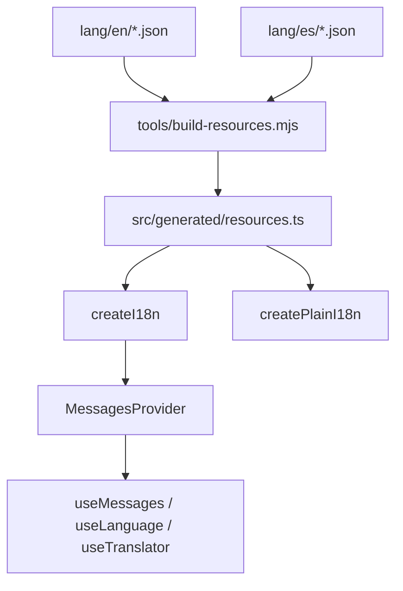

# `@mandor/i18n`

Mensajes traducidos para interfaz React y código sin React. Los textos viven por idioma y tema; el paquete genera un registro tipado para que las claves escritas en código se comprueben durante desarrollo. El consumidor elige el idioma y muestra los mensajes.

## Arquitectura

No hay clases propias. El paquete combina archivos JSON, funciones de creación de instancias i18next, un proveedor React y hooks. Cada tema de mensajes es un _namespace_: por ejemplo `menu`, `workspace` o `errors`. La misma clave puede existir en temas distintos sin chocar.



[`tools/build-resources.mjs`](tools/build-resources.mjs) lee [`src/lang/`](src/lang/), valida que los idiomas y temas coincidan, genera [`resources.ts`](src/generated/resources.ts). El inglés es idioma base y de respaldo. `DEFAULT_LANGUAGE`, `LANGUAGE_CODES` y `NAMESPACES` salen del registro generado; no se mantienen a mano.

`createI18n` crea una instancia de i18next con integración React. `MessagesProvider` la entrega al árbol y recrea la instancia cuando cambia `preferences.language`. `useMessages(namespace)` devuelve `t` para claves conocidas de ese tema. `useTranslator()` acepta una clave dinámica completa, como `menu:algo`, sin comprobación estática de esa clave. `useLanguage()` informa el idioma activo. `createPlainI18n` crea otra instancia, lista de inmediato, para código que no usa React.

El paquete depende de `i18next`, `react-i18next`, `react` y del tipo `ErrorCode` de `@mandor/ipc` para comprobar los mensajes de error. No lee preferencias globales: `MessagePreferences` llega por parámetro. Para agregar una traducción, edita los JSON del mismo tema en cada idioma y ejecuta `npm run i18n` desde el paquete. `node tools/build-resources.mjs --check` verifica si lo generado está al día.

Rutas recomendadas: [`src/create-i18n.ts`](src/create-i18n.ts), [`src/create-plain-i18n.ts`](src/create-plain-i18n.ts), [`src/MessagesProvider.tsx`](src/MessagesProvider.tsx) y [`tools/resource-schema.mjs`](tools/resource-schema.mjs).

## Uso y cambios

### Mostrar un mensaje

Monta `MessagesProvider` con la preferencia de idioma. En un componente React, `useMessages(namespace)` entrega `t` con claves comprobadas para ese grupo de mensajes. `useLanguage()` informa el idioma activo. Para código sin React, crea una instancia independiente con `createPlainI18n`; el consumidor conserva esa instancia.

Los mensajes se dividen por tema o _namespace_. Esto permite que una clave corta tenga sentidos distintos en `menu`, `workspace` y otros temas. `useTranslator()` acepta una clave completa dinámica cuando el grupo no se conoce al compilar.

### Añadir un texto

Edita el JSON del mismo tema en cada idioma dentro de [`src/lang/`](src/lang/). Ejecuta `npm run i18n` desde el paquete para regenerar el registro tipado; el generador comprueba que las claves coincidan. Sigue [`tools/build-resources.mjs`](tools/build-resources.mjs) si cambia la estructura de los recursos, y revisa las pruebas de [`tests/`](tests/) para el respaldo al inglés.

### De un JSON a una clave tipada

[`build-resources.mjs`](tools/build-resources.mjs) compara los temas y claves de `src/lang/en` y `src/lang/es`, genera el registro de recursos y los esquemas JSON. El inglés funciona como base y respaldo. Por eso una clave nueva se escribe en los dos idiomas del mismo tema y luego se regenera; no se edita el archivo generado.

`MessagesProvider` recibe `preferences.language` y crea una instancia cuando cambia ese valor. `useMessages(namespace)` restringe las claves a ese tema. `useTranslator()` acepta una clave dinámica completa cuando se conoce solo en ejecución. `createPlainI18n` sirve para menú o proceso sin árbol React, con instancia separada de la de la ventana.

## API pública

[`src/index.ts`](src/index.ts) publica estos nombres exactos:

| Grupo             | Exports                                                                         | Uso                                                                                                                             |
| ----------------- | ------------------------------------------------------------------------------- | ------------------------------------------------------------------------------------------------------------------------------- |
| Instancias        | `createI18n`, `createPlainI18n`                                                 | Crear traductor para React o para código sin React. Aceptan idioma opcional.                                                    |
| React             | `MessagesProvider`, `useMessages`, `useLanguage`, `useTranslator`, `Translator` | Dar mensajes al árbol, traducir claves de un tema, leer idioma y traducir claves dinámicas.                                     |
| Editor            | `useEditorIssueMessage`                                                         | Traduce lo que responden el chequeo de esquema y el parser JSON en el margen del editor; los avisos de XML quedan en su idioma. |
| Registro generado | `DEFAULT_LANGUAGE`, `LANGUAGE_CODES`, `Language`                                | Idioma por defecto e idiomas válidos, con su tipo TypeScript.                                                                   |

```tsx
import { MessagesProvider, useMessages } from '@mandor/i18n';

function Greeting() {
    const t = useMessages('shell');
    return <span>{t('ready')}</span>;
}

function Screen() {
    return (
        <MessagesProvider preferences={{ language: 'es' }}>
            <Greeting />
        </MessagesProvider>
    );
}
```

Para código fuera de React: `const t = createPlainI18n('es').t;`. `useTranslator` se reserva para claves que llegan como datos en tiempo de ejecución; una clave escrita a mano se beneficia del tipo de `useMessages`. Las pruebas principales son [`tests/messages.test.tsx`](tests/messages.test.tsx), [`tests/use-language.test.tsx`](tests/use-language.test.tsx) y [`tests/interface-vocabulary.test.ts`](tests/interface-vocabulary.test.ts).
