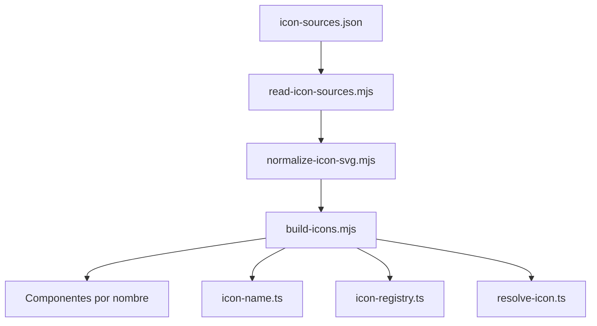

# `@mandor/icons`

Registro de iconos SVG decorativos para React. Cada intención del registro es un componente
público por nombre (`AddIcon`, `SearchIcon`…); el dibujo se pinta con el color del texto. El
paquete no conoce pantallas ni productos concretos.

## Arquitectura

La fuente de verdad es [`icon-sources.json`](icon-sources.json): una entrada por intención con su
fuente (de `@vscode/codicons` 0.0.45, propia o derivada), su hash y su estado. Las fuentes
propias viven en [`authoring/`](authoring/). [`tools/build-icons.mjs`](tools/build-icons.mjs)
lee el manifiesto con [`tools/read-icon-sources.mjs`](tools/read-icon-sources.mjs), normaliza
cada SVG con [`tools/normalize-icon-svg.mjs`](tools/normalize-icon-svg.mjs) y genera los
componentes `src/<name>.tsx`, `icon-name.ts`, `icon-registry.ts`, `resolve-icon.ts`, el barril y
su test.



Cada componente anida sus `<path>` en `IconFrame`: un `<svg>` de `viewBox="0 0 16 16"` con
`fill="currentColor"`, `data-part="icon"`, `aria-hidden="true"` y `focusable="false"`. Los
tamaños son `sm` (14 px), `md` (16 px, por defecto) y `lg` (24 px). El color explícito va por el
atributo de presentación `color` del frame; sin él, hereda `currentColor`.

El proveedor está encapsulado: solo `packages/icons` lee `@vscode/codicons`, solo en generación.
Lo comprueban la regla `mandor/no-foreign-icon-source`, la frontera `codicons-only-in-icons` de
depcruise y [`tools/tests/icon-provider-boundary.test.mjs`](../../tools/tests/icon-provider-boundary.test.mjs).

## Perfil de dibujo

Iconos **outlined**, ligeros, de interiores abiertos y terminales redondeados; lienzo base
16×16; escalas 14, 16 y 24 px (`sm`/`md`/`lg`) que heredan el peso del grid 16. `outlined`
describe el aspecto: un `path` con `fill="currentColor"` puede representar un aro con centro
transparente. Sin `stroke` ni `fill="none"` en producción: los propios se suben con los
contornos ya expandidos; un stroke editable vale solo en la mesa de dibujo.

Cada fuente de [`authoring/`](authoring/) declara en el manifiesto su origen, hash,
modificaciones y motivo. Al elegir un Codicon o dibujar una fuente propia, comprobarla a las
tres escalas y sobre claro y oscuro: el detalle que se pierde a 14 o el peso que molesta a 24
son motivo de descarte. Las marcas de proveedor se dibujan como símbolo contorneado con su
nombre visible al lado; nunca logotipos huecos inventados.

## Uso

### Icono conocido en tiempo de escritura

Importa el componente concreto. Nada de nombres por prop:

```tsx
import { AddIcon } from '@mandor/icons';

function Nuevo() {
    return (
        <span>
            <AddIcon size="sm" />
            Nuevo
        </span>
    );
}
```

Props de apariencia: `size?: 'sm' | 'md' | 'lg'`, `color?: CSSProperties['color']` y
`className`. Sin `weight`, sin handlers, sin children: el icono es decorativo y sale oculto del
árbol accesible; el control que lo contiene aporta su nombre.

### Icono que llega en datos

`<Icon name={dato} />` es la última opción: vale solo cuando el nombre llega dinámicamente, con
el registro entero como universo posible (una prop `icon` de un control genérico, un dato de
store). Con un literal, importa el componente concreto; la regla
`mandor/no-foreign-icon-source` rechaza el literal:

```tsx
import { Icon, type IconName } from '@mandor/icons';

function Fila({ icon }: { icon: IconName }) {
    return <Icon name={icon} size="sm" />;
}
```

Cuando la vista elige entre opciones conocidas, importa los concretos y elige entre ellos — una
función de vista devuelve el componente, no un nombre:

```tsx
import { type IconComponent, FileIcon, FolderIcon } from '@mandor/icons';

function iconOf(node: Node): IconComponent {
    return node.kind === 'folder' ? FolderIcon : FileIcon;
}
```

`ICON_NAMES` sigue público como dato para validar nombres y mostrar selectores.

### Añadir o cambiar una intención

Edita [`icon-sources.json`](icon-sources.json): cita el Codicon equivalente o añade la fuente a
[`authoring/`](authoring/) (canvas 16, solo `<path>`, relleno `currentColor`), con hash y
procedencia. Ejecuta `npm run icons` y revisa lo generado; `npm run icons -- --check` falla si
las salidas quedaron atrás, faltan o sobran. El registro activo exige toda intención `approved`:
el generador se niega a salir con entradas `candidate`.
