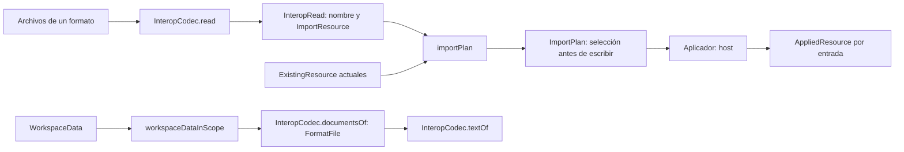

# @mandor/interop-core

Modelo común para importar y exportar. Describe el documento intermedio, el contrato de los formatos, los cambios propuestos antes de escribir y las piezas que todos los formatos comparten al leer y al escribir. Recibe y devuelve datos; quien lo usa lee los archivos, escribe en disco y pide decisiones.

## Arquitectura

`InteropDocument` es el modelo intermedio (IR): una forma común de expresar documentos de distintos formatos. Un formato lee sus archivos y propone recursos del espacio; el plan los compara con los que el espacio ya tiene.



Cada formato concreto vive en `@mandor/interop-formats` e implementa `InteropCodec`; este paquete no conoce ninguno. El aplicador del host escribe las entradas elegidas y responde un `AppliedResource` por cada una, con su motivo si no se escribió.

### Límites y navegación

Dependencias de ejecución: `@mandor/schema` para el dominio, `zod` para los esquemas y `yaml` para escribir documentos. Las carpetas siguen las dos direcciones: [`src/import/`](src/import/) (documento → recursos) y [`src/export/`](src/export/) (espacio → documento), más [`src/ir/`](src/ir/) para el modelo, [`src/format/`](src/format/) para el contrato de un formato, [`src/plan/`](src/plan/) y [`src/resource/`](src/resource/) para la comparación, [`src/scope/`](src/scope/) para el alcance y [`src/workspace/`](src/workspace/) para leer el espacio como IR. Pruebas: `npm run ci:test -- packages/interop-core`.

## Uso y cambios

### Preparar una importación

Un `InteropCodec` lee los archivos (`InteropFile`: ruta relativa y texto) de un formato y devuelve un `InteropRead`: el nombre que el documento se dio y los `ImportResource[]` que el espacio guardaría. Reúne también los `ExistingResource` del destino. `importPlan(resources, existing)` compara ambos grupos antes de escribir: cada entrada queda como alta, actualización, eliminación o conflicto. El consumidor muestra esa propuesta y decide qué entradas aplicar.

### Decisiones antes de escribir

[`importPlan`](src/plan/import-plan.ts) compara cada propuesta por `place` y `route`, cada una contra su propio origen: los archivos de una misma importación pueden venir de varias fuentes (una colección y un entorno, cada uno con la suya) y ninguna estorba a las otras; el primer origen nombra la importación. Una ruta libre es `add`; una ruta del mismo origen es `update`; una ruta de otro origen es `conflict`. Lo que ese origen importó antes y el documento nuevo ya no trae aparece como `removal`.

Las altas y actualizaciones normales empiezan seleccionadas. Una actualización cuyo contenido cambió desde la importación, y toda eliminación, empiezan sin seleccionar para preservar trabajo local. `fingerprintOf` es la huella de ese contenido: detecta cambios, no autoriza ni cifra. `irDiff` compara documentos por significado e ignora el orden de colecciones y `sourceId`.

### Crear un formato nuevo

Implementa las tres operaciones de [`InteropCodec`](src/format/interop-format.ts): `read(files, scope)`, `documentsOf(data)` y `textOf(document)`; y declara en su `InteropFormat` los `scopes` que cubre, el `input` que el usuario elige (`file`, `files` o `folder`) y `sniff(files)`, que reconoce sus archivos sin cargar el codec. Antes de escribir una pieza nueva, busca en la tabla de abajo: el cuerpo de formulario, la autenticación, las rutas libres, las filas con nombre y la conexión WebSocket ya tienen una sola forma para todos los formatos. Un documento que no se puede leer se rechaza con `FormatInputError`, o con una clase propia del formato que herede de ella; un documento de la otra app, con `ImportOtherAppError`.

## API pública

La API exportada está reunida en [`src/index.ts`](src/index.ts). Son tipos y funciones libres; las únicas clases son los dos rechazos, `FormatInputError` e `ImportOtherAppError`.

| Área                | Exportaciones principales                                                                                                                          | Para qué sirve                                                                                                                   |
| ------------------- | -------------------------------------------------------------------------------------------------------------------------------------------------- | -------------------------------------------------------------------------------------------------------------------------------- |
| Modelo intermedio   | `InteropDocument` y sus partes (`InteropServer`, `InteropChannel`, `InteropOperation`, `InteropHttpOperation`…), `interopDocumentSchema`, `irDiff` | El documento común, su validación y su comparación por significado.                                                              |
| Contrato de formato | `InteropFormat`, `InteropCodec`, `InteropRead`, `InteropFile`, `FormatFile`, `FormatDocument`, `FormatInputError`, `ImportOtherAppError`           | Lo que un formato declara e implementa; los rechazos de un documento ilegible o de la otra app.                                  |
| Entrada y archivos  | `INTEROP_INPUTS`, `readSoleDocument`, `soleFileOf`, `sniffSoleFile`, `documentRootOf`, `documentYamlOf`                                            | Qué elige el usuario y cómo se lee o escribe un documento de un solo archivo.                                                    |
| Alcance             | `INTEROP_SCOPES`, `InteropScope`, `resourcesInScope`, `workspaceDataInScope`, `selectWorkspaceData`                                                | Qué parte del espacio entra en una importación o una exportación.                                                                |
| Recursos y plan     | `ImportResource`, `ExistingResource`, `AppliedResource`, `ResourcePlace`, `StorableKind`, `importPlan`, `importPlanSchema`, `leaveOutUnstored`     | La propuesta, lo que hay, lo que respondió la escritura y la comparación entre ellos.                                            |
| Huellas             | `fingerprintOf`, `environmentFingerprint`, `workspaceFingerprint`                                                                                  | Detectan si lo importado cambió desde la última vez.                                                                             |
| Leer un documento   | `treeResourcesOf`, `environmentResources`, `socketResources`, `formBodyOf`, `binaryBodyOf`, `checkedAuth`, `claimRoute`, `variablesOf`…            | Piezas comunes para pasar de un documento a recursos del espacio, sin que cada formato escriba la suya.                          |
| Escribir uno        | `workspaceToIr`, `workspaceOutline`, `collectionsToWrite`, `concreteAuthOf`, `namedRowsOf`, `withoutLiteralSecret`, `claimStem`…                   | Leer el espacio como IR o como árbol, y las piezas comunes para escribirlo sin secretos literales ni nombres dobles.             |
| Elección por clave  | `chooseByKey`, `KeyHandlers`                                                                                                                       | Elige por la clave de una unión desde una tabla: un valor que falta no compila y cada manejador recibe su miembro ya estrechado. |

Ejemplo de vista previa sin escritura:

```ts
import { importPlan, type ExistingResource, type ImportResource } from '@mandor/interop-core';

function preview(resources: ImportResource[], existing: ExistingResource[]) {
    return importPlan(resources, existing).entries;
}
```
