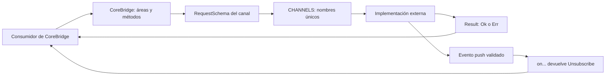

# `@mandor/ipc`

Contrato del puente entre una ventana y su proceso anfitrión. Define nombres de canales, formas de solicitudes y respuestas, áreas de la API y un resultado común para éxito o fallo. No registra manejadores ni ejecuta operaciones: otro paquete implementa este contrato.

## Arquitectura

IPC significa comunicación entre procesos. Este paquete describe lo que una ventana puede pedir y lo que el anfitrión puede responder o emitir, sin decidir cómo se hace el trabajo.



`CoreBridge` es un tipo, no una clase ni una implementación. Agrupa `origin`, `workspace`, `collection`, `import`, `environment`, `secret`, `export`, `doc`, `session`, `menu` y `window`. Las áreas adicionales `ConnectionArea`, `WsArea`, `RecordArea` y `JsonlExportArea` se pueden componer fuera del núcleo. Así el contrato compartido no tiene que conocer una aplicación concreta.

Cada archivo por operación define su solicitud con Zod y, cuando hay respuesta estructurada, el esquema de respuesta. `CHANNELS` evita escribir nombres de canal como cadenas sueltas. La respuesta cruza como `Result<T>`: `{ ok: true, value }` o `{ ok: false, error: { code, message } }`. El código permite decidir qué presentar; el mensaje es diagnóstico. Los eventos de estado usan funciones `on...` que devuelven `Unsubscribe`, de modo que el consumidor libere la suscripción.

El contrato no transmite una ruta de repositorio desde la ventana para operaciones de origen o espacio. El anfitrión resuelve esa ruta. Los valores secretos tienen canales separados: `kept` devuelve nombres con valor, `reveal` pide uno por nombre. La colección separa `tree` (estructura y metadatos) de `readItem` (contenido) para no cargar todos los cuerpos al listar.

`@mandor/ipc/testing` exporta `createFakeBridge`, que devuelve respuestas válidas y emisores de eventos para pruebas. No simula lógica de negocio. Empieza en [`src/bridge/core-bridge.ts`](src/bridge/core-bridge.ts), sigue [`src/channel/channels.ts`](src/channel/channels.ts) y después la carpeta del área que quieras cambiar. [`tests/`](tests/) agrupa contratos por área; `npm run ci:test -- packages/ipc` ejecuta sus pruebas desde la raíz.

## Uso y cambios

### Cambiar el contrato

Para una operación nueva, añade un nombre de canal, un esquema que valide la solicitud y el método tipado del área correspondiente. Después implementa el handler fuera de este paquete y conecta el preload. Si cambia una respuesta, actualiza también la validación del resultado, el doble de [`testing`](src/testing/) y las pruebas de [`tests/`](tests/). Esta secuencia mantiene la misma forma en ambos lados del límite de procesos.

### Contrato de una llamada

Empieza por el método de `CoreBridge` o de un área adicional, localiza su nombre en [`CHANNELS`](src/channel/channels.ts) y su esquema `RequestSchema`. El preload y el handler usan ese contrato. El resultado cruza como `Result<T>`: `ok: true` incluye `value`; `ok: false` incluye `error.code` para decidir la respuesta de la interfaz y `error.message` para diagnóstico. Las excepciones del proceso principal no se lanzan directamente al renderer.

El árbol de las colecciones se consulta aparte del cuerpo de cada elemento: `tree` trae estructura y metadatos, `readItem` trae contenido. Los secretos también tienen operaciones separadas para consultar nombres guardados y revelar un valor concreto. Estas separaciones limitan los datos que cruza cada llamada.

Para un evento del host, el método `on...` del bridge devuelve `Unsubscribe`. El consumidor debe ejecutarlo al desmontar para evitar recibir eventos de una vista cerrada. [`createFakeBridge`](src/testing/) permite probar consumidores contra la misma forma del contrato.

`CoreBridge` agrupa las áreas comunes. Conexiones, WebSocket, registros y exportación JSONL se añaden mediante áreas separadas cuando un consumidor las necesita. [`src/bridge/`](src/bridge/) muestra cómo se compone la forma pública del puente.

## API pública

Entrada normal: [`src/index.ts`](src/index.ts). Los esquemas terminados en `RequestSchema` validan lo que se pide; los terminados en `ResultSchema` validan lo que vuelve. Los tipos con el mismo prefijo son los datos inferidos o descritos. `CHANNELS` contiene el nombre exacto de cada operación y evento.

### Base del puente

| Exportaciones                                                                  | Uso                                                                                                |
| ------------------------------------------------------------------------------ | -------------------------------------------------------------------------------------------------- |
| `CoreBridge`, `Unsubscribe`, `CHANNELS`, `Channel`                             | Forma del puente común, baja de suscripciones y nombres de canales.                                |
| `Result`, `Err`, `Empty`, `success`, `failure`, `ErrorCode`, `errorCodeSchema` | Resultado uniforme. `success(value)` envuelve datos; `failure(code, message)` envuelve un rechazo. |

```ts
import { CHANNELS, success, type Result } from '@mandor/ipc';

const channel = CHANNELS.workspaceList;
const answer: Result<string[]> = success(['demo']);
if (answer.ok) console.log(answer.value);
```

### Áreas

El barril [`src/index.ts`](src/index.ts) es la lista exacta: exporta solo lo que otro paquete o
una app importa. Cada carpeta de `src/` es un área; cada archivo, una operación con su canal, su
solicitud y, cuando la respuesta tiene forma, su resultado.

| Carpeta                                                             | Qué cubre                                                                          |
| ------------------------------------------------------------------- | ---------------------------------------------------------------------------------- |
| `channel/`, `result/`, `bridge/`                                    | Nombres de canal, `Result` con sus códigos de error y la forma de cada área.       |
| `origin/`, `workspace/`, `repo/`                                    | Alta, comprobación, lista, cambio y retiro de orígenes; espacios y sus variables.  |
| `collection/`, `doc/`                                               | Árbol, cuerpo de cada item, cambios y búsqueda; documentos markdown.               |
| `environment/`, `secret/`, `network/`                               | Entornos y el activo; secretos guardados y revelados; proxy y certificados.        |
| `import/`, `export/`                                                | Elegir, planear y aplicar una importación; el árbol y la escritura de un export.   |
| `conflict/`, `notice/`, `update/`, `log/`                           | Conflictos de sincronización, avisos, actualizaciones y el registro de la ventana. |
| `session/`, `menu/`, `window/`, `language/`                         | Sesión restaurada con su rejilla, menú, cromo de la ventana e idioma.              |
| `connection/`, `ws/`, `record/`                                     | Solo Realtime: conexiones guardadas, sockets en vivo y grabación de la actividad.  |
| `request/`, `history/`, `cookies/`, `auth/`, `codegen/`, `graphql/` | Solo Request: envío, historial, cookies, autenticación, snippets y GraphQL.        |

La subruta `@mandor/ipc/testing` exporta `createFakeBridge` y sus tipos auxiliares para pruebas. El paquete depende de `@mandor/schema`, `@mandor/interop-core` y `zod`; los archivos por área están en [`src/`](src/).
