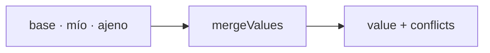

# `@mandor/merge`

Fusiona tres versiones de un valor o de un archivo: la base, la mía y la ajena. Devuelve el resultado y la lista de choques que no puede decidir solo; con las decisiones del usuario, devuelve el resultado final. No abre archivos ni habla con git: recibe valores o textos y devuelve valores o textos.

## Arquitectura

`mergeValues` recorre los tres valores a la vez. Si un lado no se movió, gana el otro; si los dos se movieron igual, no hace falta la base. Los objetos se fusionan clave a clave, con el orden de lo mío y las claves nuevas de lo ajeno al final. Donde los dos lados cambiaron lo mismo y distinto, el valor provisional es el mío y queda un choque.

Las listas se fusionan según lo que contienen:

- **Filas** (cabeceras, query, variables): listas de objetos que se nombran con `id`, si no `name`, si no `key`. La fila se identifica por ese campo más su ocurrencia (`Accept#0`, `Accept#1`): la clave repetida es legal. Cada fila se fusiona campo a campo, y un campo que chocó convierte toda la fila en el choque.
- **Conjuntos ordenados** (orden de una carpeta): listas de strings. Las quitas de cualquier lado se aplican y las altas ajenas van tras su vecina. El orden nunca pregunta.
- **Otras listas**: un choque `value` sobre la lista entera.

El texto libre (un documento, o una cadena con saltos de línea) se fusiona por líneas con `node-diff3`. Los trozos limpios entran; si los dos lados editaron las mismas líneas queda un único choque `text` que lleva los tres textos enteros y `proposed`, el resultado con lo mío en los trozos chocados.

## Archivos

`mergeFile` recibe la ruta y el texto de un archivo en cada lado (`null` si no está) y devuelve el texto fusionado y los choques. La ruta solo sirve para elegir el tipo por su extensión.

- Atajos: dos lados iguales, o un lado que no se movió, dan el otro sin leer nada. Un borrado que nadie contradijo se sigue.
- Borrado contra cambio, un archivo que no se puede leer o de un tipo desconocido: un único choque `file` con id `''` y los tres textos. Mientras nadie responde, el texto es el mío (`null` si lo borré yo).
- **YAML** (`.yaml`): se fusiona como los valores que contiene y el resultado se escribe en el documento mío, tocando solo lo que cambió. Los comentarios, el orden y el estilo del resto sobreviven. Una lista que cambió se sustituye entera, y con ella sus comentarios internos.
- **Markdown** (`.md`): el archivo entero es un texto y se fusiona por líneas.

## Decisiones

`resolveFile(input, choices)` repite la fusión con las respuestas del usuario, indexadas por el `id` del choque. No guarda nada entre la pregunta y la respuesta: como la fusión es una función pura de los tres textos, los mismos textos dan los mismos `id`.

Una decisión (`Decision`) es `{ pick: 'ours' | 'theirs' }`, que vale para cualquier choque, o `{ text }`, que solo vale para `text` y `file`: un valor o una fila se elige entre lo que hay, no se escribe. Una decisión que no vale, o cuyo `id` no corresponde a ningún choque, se ignora y la pregunta sigue abierta.

Un choque (`MergeConflict`) lleva un `id` formado con su ruta unida por `/`. Calcular de nuevo da los mismos `id`, y así una decisión encuentra su pregunta.

## API pública

Importa desde `@mandor/merge`; [`src/index.ts`](src/index.ts) es su única entrada.

| Exportación   | Contrato                                                                        |
| ------------- | ------------------------------------------------------------------------------- |
| `mergeFile`   | `{ path, base, ours, theirs }` con textos (o `null`) dan `{ text, conflicts }`. |
| `resolveFile` | Lo mismo con `choices` por `id` de choque; deja abierto lo que no se responde.  |
| `Decision`    | La respuesta a un choque, la que `resolveFile` recibe en `choices` por su `id`. |
