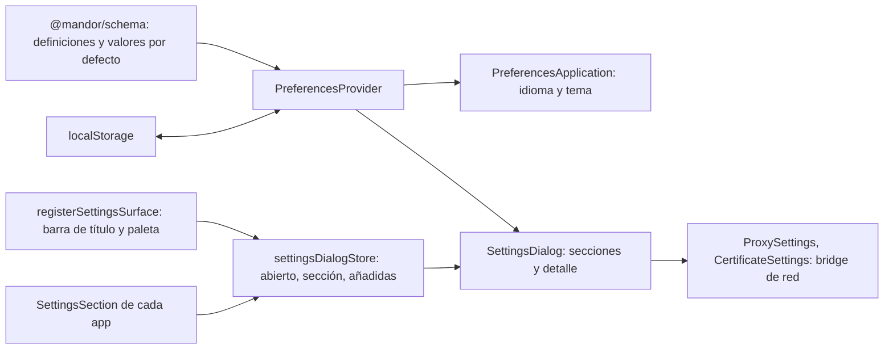

# `@mandor/prefs`

Ajustes de la app: lee los valores guardados, completa los que faltan con los predeterminados, comunica idioma y tema al documento y ofrece el diálogo donde se cambian, con la red (proxy y certificados) incluida. El paquete no decide qué app lo abre ni qué secciones propias añade cada una.

## Arquitectura



`PreferencesProvider` crea el contexto React. Lee `mandor.preferences` de `localStorage`, conserva solo las claves de `PREFERENCE_DEFINITIONS` y completa lo que falte con `resolvePreferenceValues` de `@mandor/schema`; un JSON ilegible cuenta como vacío. Al cambiar una opción escribe el objeto nuevo y actualiza el contexto. `PreferencesApplication` pone el idioma en `<html lang>` y el tema explícito en `data-theme`; con el tema `system` retira el atributo.

`SettingsDialog` es maestro y detalle: a la izquierda las secciones, a la derecha la elegida. Abre con las comunes (apariencia, actualizaciones, proxy, certificados), sigue con las que añade la app y cierra con los atajos, que se leen y no se cambian. El estado vive en un store de ventana: cambiar de origen no cierra ni cambia los ajustes. El proxy y los certificados son de la máquina, no de una app, y se leen y escriben por el bridge de red; las escrituras salen una tras otra para que el disco no quede con los ajustes de una tecla atrás.

## Uso y cambios

### Montar los ajustes

Envuelve el árbol con `PreferencesProvider` y, dentro, `PreferencesApplication`. El componente raíz de la app monta `SettingsDialog` una vez y llama `registerSettingsSurface()` al montar sus registros: así la barra de título y la paleta abren el diálogo. Ejecuta la función devuelta al desmontar.

```tsx
import type { PropsWithChildren } from 'react';
import { PreferencesApplication, PreferencesProvider } from '@mandor/prefs';

function PreferencesRoot({ children }: PropsWithChildren) {
    return (
        <PreferencesProvider>
            <PreferencesApplication>{children}</PreferencesApplication>
        </PreferencesProvider>
    );
}
```

### Añadir una sección de una app

La app escribe `<SettingsSection id icon titleKey>` en su árbol con el cuerpo como hijos; mientras está montada, el diálogo la muestra entre las comunes y los atajos. Un campo que hereda de esa sección usa `useSettingsInheritance(id)` para decir de dónde viene el valor y llevar a él con `openSettings(id)`.

### Añadir una preferencia

Define clave, sección, valor válido y predeterminado en `@mandor/schema`, y los mensajes en `@mandor/i18n`. [`PreferenceRows`](src/components/dialog/PreferenceRows.tsx) dibuja las definiciones de cada sección en su orden; si el tipo nuevo necesita otro control, amplía [`PreferenceRow`](src/components/dialog/PreferenceRow.tsx) y cúbrelo con una prueba. No hay una segunda lista escrita a mano.

## API pública

| Exportación                 | Uso                                                                                                                     |
| --------------------------- | ----------------------------------------------------------------------------------------------------------------------- |
| `PreferencesProvider`       | Contexto de las preferencias guardadas y resueltas. Va antes que cualquier otro componente del paquete.                 |
| `PreferencesApplication`    | Aplica idioma y tema al documento y entrega los mensajes traducidos a sus hijos. Dentro de `PreferencesProvider`.       |
| `SettingsDialog`            | El diálogo de ajustes. Se monta una vez por ventana.                                                                    |
| `registerSettingsSurface()` | Cuelga el diálogo de la superficie `settings` del shell. Devuelve su baja.                                              |
| `openSettings(section?)`    | Abre el diálogo en una sección, o en la primera; si ya está abierto, va a ella.                                         |
| `SettingsSection`           | Declara en el árbol una sección de la app con `id`, icono y `titleKey`; sus hijos son el cuerpo. Desmontarla la retira. |
| `useSettingsInheritance`    | Textos y acción de la línea que dice, bajo un campo heredado, en qué sección de los ajustes está su valor.              |

El paquete expone la interfaz; `@mandor/schema` conserva la lista de opciones y sus valores válidos.
