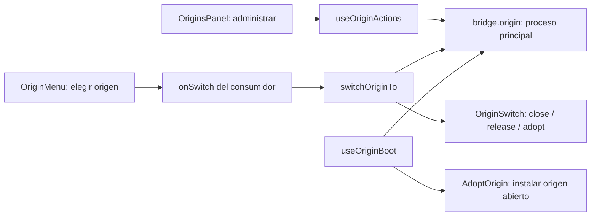

# `@mandor/repos`

Administra **orígenes**: lugares locales o remotos que contienen espacios de trabajo. El paquete ofrece operaciones de lista, alta, comprobación, cambio, renombrado, vaciado y eliminación. También dibuja el selector, la página de administración y la pestaña donde la persona responde un choque que la sincronización no pudo unir sola. El proceso principal ejecuta esas operaciones; este paquete llama al contrato de `@mandor/ipc` mediante `@mandor/shell`.

## Arquitectura

No hay clases principales. La estructura usa funciones, componentes React y contratos de callbacks:

### Cambio de origen

`switchOriginTo` evita cambios duplicados o simultáneos. Marca el cambio en el shell, espera el cierre de recursos aportado por la aplicación, guarda la sesión anterior, libera el estado derivado y cierra ese origen en la interfaz. Luego pide abrir el nuevo y llama a `adopt`. Si la apertura falla, vuelve a cargar la sesión anterior. Finalmente quita la marca de cambio. Esta secuencia importa cuando un consumidor mantiene conexiones o datos asociados al origen anterior.

`OriginsPanel` lee la lista mediante `listOrigins`, comprueba una vez cada origen remoto al aparecer y muestra el estado. `useOriginActions` conecta diálogos, operaciones y errores de la interfaz. Las vistas no guardan la lista de orígenes por su cuenta: `shellStore` la comparte con el selector.

### Choques

Cuando una escritura o una unión deja un choque para la persona, main lo guarda y avisa. `ConflictToasts` lo dice con un aviso que ofrece la pestaña; `ConflictTabKind` la registra. La pestaña se llama siempre «Conflictos» y dibuja el choque por la forma de sus preguntas, nunca por el tipo de lo que chocó: una petición, un mensaje, un entorno y un doc se responden igual. Las respuestas a medias viven en `conflictDrafts`; cerrar a mano con respuestas pregunta antes, y soltar la pestaña suelta sus respuestas. Un choque resuelto desde otro sitio pasa a «nada que resolver». La lista y el detalle solo escuchan la pregunta más reciente, así que una respuesta lenta nunca pisa a una más nueva.

## Uso y cambios

### Arrancar con un origen

`useOriginBoot(adopt)` lee los orígenes, los instala en el shell y abre uno cuando todavía no hay origen activo. El callback `adopt` lo entrega el consumidor: recibe el origen abierto e instala sus propios datos. `OriginMenu` ofrece el selector; `OriginsPanel` ofrece la administración y usa el mismo estado compartido.

### Recorrido de un cambio de origen

Usa [`switchOriginTo`](src/lib/switch-origin-to.ts) cuando la ventana ya tiene recursos abiertos. Ignora el origen ya abierto y otro cambio en curso. Marca el estado de transición, espera `close`, guarda la sesión anterior con `flushSession`, llama `release` y vacía el origen activo antes de abrir el nuevo. Si la apertura funciona, llama `adopt`; si falla, recarga la sesión anterior. La marca se retira incluso cuando una llamada falla.

La interfaz solo pide estas operaciones. `addOrigin`, `checkOrigin`, `removeOrigin` y el vaciado que pide `EmptyOriginDialog` son llamadas al bridge; el proceso principal decide rutas, acceso remoto y cambios en disco. `checkOrigin` puede devolver `reachable: false` como respuesta correcta: ese dato describe disponibilidad, no un fallo del canal.

Para añadir una operación, revisa su contrato en `@mandor/ipc`, la función de [`src/lib/`](src/lib/) y la acción de [`useOriginActions`](src/hooks/useOriginActions.ts). Comprueba el recorrido en [`tests/`](tests/).

## API pública

| Exportación                                 | Qué ofrece                                                                                                                             |
| ------------------------------------------- | -------------------------------------------------------------------------------------------------------------------------------------- |
| `listOrigins()`, `addOrigin(input)`         | Obtienen los orígenes conocidos y solicitan guardar uno nuevo. El alta valida el destino en el proceso principal.                      |
| `checkOrigin(id)`                           | Comprueba si un origen remoto responde. `reachable: false` es un resultado válido; un `Result` fallido indica error de operación.      |
| `renameOrigin(request)`, `removeOrigin(id)` | Cambian el nombre, o quitan el origen y su copia local.                                                                                |
| `switchOriginTo(id, app)`                   | Ordena el cambio completo. `app` aporta `close?`, `release?` y `adopt`; el paquete no presupone qué recursos mantiene la aplicación.   |
| `useOriginBoot(adopt)`                      | Lista los orígenes al montar la ventana, instala la lista en el shell y abre el primero si aún no hay uno activo.                      |
| `OriginMenu`, `EmptyOriginDialog`           | Selector de origen y diálogo de vaciado. `OriginMenu` recibe el cambio de origen por callback.                                         |
| `OriginsTabKind`, `openOriginsTab()`        | Declara en el árbol la pestaña de gestión y su superficie `origins`, y recibe `onSwitch`; `openOriginsTab()` la abre o la enfoca.      |
| `ConflictTabKind`, `ConflictToasts`         | Declara la pestaña de choques; avisa de cada choque nuevo con la acción que la abre. Se monta una vez, dentro del proveedor de avisos. |

Ejemplo: `await switchOriginTo(id, { adopt, close, release });`. El consumidor aporta la preparación y limpieza propias de su ventana mediante esos callbacks.
