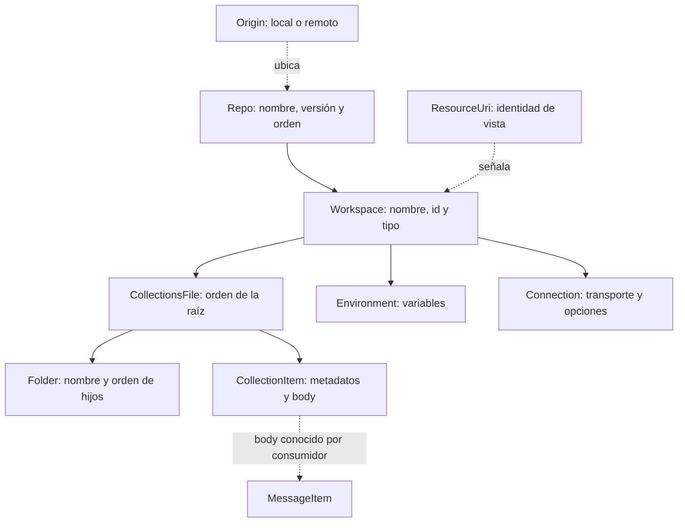
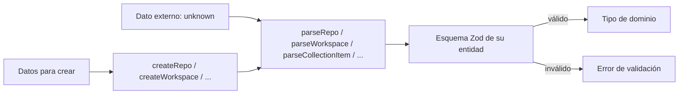

# @mandor/schema

Modelos y reglas de datos compartidos: repositorios, espacios, colecciones, conexiones, entornos, orígenes y recursos. Valida valores externos con Zod y crea entidades válidas. No lee ni escribe archivos.

## Arquitectura

Las entidades son tipos de datos; las funciones crean o validan instancias. No hay una jerarquía de clases de dominio. `FormatError`, `FormatVersionError`, `IdError` y `OriginUrlError` son las clases de error que salen del paquete para entradas inválidas.



`CollectionItem.body` es abierto: la colección conserva campos cuyo significado define quien use el elemento. `MessageItem` es uno de esos contenidos y no tiene una conexión fija. El orden se guarda en `Repo.workspaces`, `CollectionsFile.order` y `Folder.order`, cerca de cada grupo. `ResourceUri` nombra una vista por ruta canónica; sus ámbitos son `app`, `settings` y `workspace`.

### Entrada de datos



Usa `parse*` al leer datos externos. Usa `create*` cuando se crea una entidad nueva. `SUPPORTED_FORMAT` limita el formato de repositorio que este código entiende; `parseRepo` lanza `FormatVersionError` si recibe una versión posterior. Quien llama decide cómo presentarla. `resolvePreferenceValues` aplica precedencia `app`, luego `repo`, luego `workspace`, y usa el valor por defecto si el guardado no es válido.

### Límites y navegación

Dependencia de ejecución: `zod`. La lectura y escritura YAML está en `@mandor/store-fs`; plantillas y secretos, en `@mandor/vars`; contratos del puente, en `@mandor/ipc`. Para cambiar un campo, empieza por su entidad en [`src/`](src/): tipo, esquema, parser y fábrica viven en la misma carpeta. Las pruebas reflejan esas carpetas en [`tests/`](tests/) (por ejemplo `collection`, `connection`, `resource` y `workspace`). Ejecuta `npm run ci:test -- packages/schema` desde la raíz del monorepo.

## Uso y cambios

### Elegir la entrada adecuada

Cuando el dato viene de un archivo, IPC o una importación, trátalo como `unknown` y pásalo por el `parse*` de su entidad. Cuando necesitas construir una entidad nueva, usa `create*`: la fábrica valida la entrada y completa los campos que debe calcular. Los tipos describen el resultado; no validan nada durante la ejecución.

Por ejemplo, `createWorkspace` recibe el nombre, tipo e identificadores ocupados para generar un ID libre. `parseRepo` comprueba también la versión del formato antes de aceptar un repositorio. Los errores de formato, ID, origen y URI están separados para que el consumidor distinga la causa.

### Seguir un campo nuevo

Busca la entidad en [`src/`](src/): tipo, esquema, parser y fábrica suelen estar juntos. Si el campo se guarda, comprueba la lectura y escritura en `@mandor/store-fs`; si cruza procesos, revisa `@mandor/ipc`. Añade casos válidos e inválidos en la carpeta correspondiente de [`tests/`](tests/). Para rutas de recursos y orden de las colecciones, usa las funciones de este paquete en vez de formar cadenas a mano.

### Contratos que conviene conocer

`parseRepo(input)` recibe `unknown`. Si `formatVersion` es un entero posterior a `SUPPORTED_FORMAT`, lanza `FormatVersionError` antes de aplicar el esquema: el consumidor puede abrir esos datos solo en modo lectura o pedir una versión compatible. Los demás analizadores de entidad usan su esquema Zod para rechazar forma y tipos inválidos.

`createWorkspace` genera un ID libre a partir del nombre y de los IDs existentes. `reconciledOrder` combina el orden guardado con los elementos presentes, útil cuando un archivo cambió fuera de la aplicación. `formatResourceUri` y `parseResourceUri` forman y leen identidades de vista; el disco y la pestaña no deben inventar su propia sintaxis.

Una entidad nueva necesita un tipo, un esquema de entrada, un parser y, cuando se crea desde la interfaz, una fábrica. Revisa también el formato YAML y el contrato IPC que la transporta. Las carpetas de [`tests/`](tests/) muestran los casos válidos, los límites de nombres y los errores de versión.

## API pública

La entrada única es [`src/index.ts`](src/index.ts). Los tipos `Repo`, `Workspace`, `CollectionsFile`, `Folder`, `CollectionItem`, `Connection`, `Environment`, `Variable`, `Origin`, `MessageItem` y `ResourceUri` describen datos; sus esquemas y analizadores comprueban valores externos. Las fábricas devuelven objetos válidos y calculan identificadores cuando corresponde.

| Área                             | Exportaciones                                                                                                                                                                                                                                                                                                                                                                                                                               | Uso                                                                                                                         |
| -------------------------------- | ------------------------------------------------------------------------------------------------------------------------------------------------------------------------------------------------------------------------------------------------------------------------------------------------------------------------------------------------------------------------------------------------------------------------------------------- | --------------------------------------------------------------------------------------------------------------------------- |
| Repositorio y espacio            | `Repo`, `repoSchema`, `parseRepo`, `createRepo`, `Workspace`, `WorkspaceKind`, `workspaceSchema`, `parseWorkspace`, `createWorkspace`, `WorkspaceBundle`, `workspaceBundleSchema`, `workspaceVariableSchema`                                                                                                                                                                                                                                | Validar y crear contenedores. `createWorkspace` genera un `id` desde el nombre y los ids existentes.                        |
| Colecciones                      | `CollectionsFile`, `collectionsFileSchema`, `parseCollectionsFile`; `Folder`, `folderSchema`, `parseFolder`; `CollectionItem`, `CollectionItemFields`, `collectionItemEnvelopeSchema`, `collectionItemFields`, `parseCollectionItem`; `CollectionNode`, `CollectionFolderNode`, `CollectionFile`, `parseCollectionFile`, `CollectionSetNode`, `collectionNodeSchema`, `collectionItemMark`                                                  | Separar árbol, metadatos comunes y contenido abierto de cada elemento.                                                      |
| Rutas y orden de las colecciones | `CollectionPlace`, `collectionPlace`, `childPath`, `collectionPathSchema`, `collectionParentSchema`, `collectionItemPaths`, `reconciledOrder`; `ItemOrigin`, `ItemOriginKind`, `itemOriginSchema`                                                                                                                                                                                                                                           | Construir rutas, verificar segmentos, reconciliar el orden guardado con los elementos presentes y atribuir una importación. |
| Conexión                         | `Connection`, `connectionSchema`, `parseConnection`, `createConnection`, `CreateConnectionInput`; `ConnectionTransport`, `CONNECTION_TRANSPORTS`, `DEFAULT_CONNECTION_TRANSPORT`, `connectionTransportSchema`; `connectionUrlSchema`, `urlMatchesTransport`, `urlForTransport`, `connectionExtrasOf`                                                                                                                                        | Definir conexión persistida, transporte y URL compatible.                                                                   |
| Opciones de conexión             | `keepaliveOptionsSchema`, `DEFAULT_KEEPALIVE_OPTIONS`; `retryOptionsSchema`, `DEFAULT_RETRY_OPTIONS`; `SocketIoEngineTransport`, `socketIoOptionsSchema`, `DEFAULT_SOCKETIO_OPTIONS`, `SOCKETIO_ENGINE_TRANSPORTS`; `websocketOptionsSchema`, `DEFAULT_WEBSOCKET_OPTIONS`, `SUBPROTOCOL_PATTERN`; `parseFrameTemplate`, `applyFrameTemplate`, `handshakeOptionsSchema`, `DEFAULT_HANDSHAKE_OPTIONS`, `SocketIoVersion`, `SOCKETIO_VERSIONS` | Validar opciones opcionales y preparar tramas a partir de una plantilla.                                                    |
| Entorno y variables              | `Environment`, `environmentSchema`, `parseEnvironment`, `createEnvironment`, `Variable`, `variableSchema`, `variableNameSchema`                                                                                                                                                                                                                                                                                                             | Definir conjuntos de variables. La resolución de `{{nombre}}` vive en `@mandor/vars`.                                       |
| Mensaje                          | `MessageItem`, `parseMessageItem`, `createMessageItem`, `messageItemBody`, `MESSAGE_ITEM_KIND`, `MessagePayloadType`, `MESSAGE_PAYLOAD_TYPES`, `parseMessagePayloadType`                                                                                                                                                                                                                                                                    | Validar un elemento de mensaje, su carga útil y tipo.                                                                       |
| Origen                           | `Origin`, `OriginKind`, `LOCAL_ORIGIN_ID`, `originSchema`, `createOrigin`, `createLocalOrigin`, `OriginHost`, `originHostOf`, `isOriginUrl`, `splitOriginUrl`, `OriginUrlError`, `OriginSyncState`, `OriginSyncStateName`, `ORIGIN_SYNC_STATES`, `originSyncStateSchema`                                                                                                                                                                    | Describir origen local o remoto y analizar su URL, sin exponer una ruta de disco.                                           |
| Documento y nombres              | `docNameSchema`, `isDocName`, `assertDocName`, `docTitle`, `docFileName`; `entityNameSchema`, `slugSchema`; `SEGMENT`, `slugify`, `assertSegment`, `segmentsOf`, `IdError`                                                                                                                                                                                                                                                                  | Comprobar nombres, formar ids y convertir título de documento en nombre de archivo.                                         |
| Recursos y preferencias          | `ResourceUri`, `ResourceUriParts`, `resourceUriSchema`, `parseResourceUri`, `formatResourceUri`, `RESOURCE_URI_SCHEME`, `PreferenceDefinition`, `PREFERENCE_DEFINITIONS`, `PreferenceKey`, `PreferenceValues`, `ResolvedPreferenceValues`, `resolvePreferenceValues`                                                                                                                                                                        | Identificar recursos y resolver preferencias desde las capas `app`, `repo` y `workspace`.                                   |
| Autenticación                    | `AuthConfig`, `ConcreteAuth`, `BasicAuth`, `BearerAuth`, `ApiKeyAuth`, `ApiKeyPlacement`, `DigestAuth`, `AwsSigV4Auth`, `OAuth2ClientCredentials`, `OAuth2CodePkce`, `authConfigSchema`, `concreteAuthSchema`, `redirectPortSchema`, `AuthPlace`, `AuthChainLevel`, `authChainLevelSchema`                                                                                                                                                  | La autenticación de cada nivel (heredar o un esquema concreto), el nivel que toca una llamada y la cadena que la resuelve.  |
| Petición HTTP                    | `RequestItem`, `requestItemSchema`, `parseRequestItem`, `createRequestItem`, `REQUEST_ITEM_KIND`, `requestItemBody`, `RequestLine`, `KeyValueMeta`, `KEY_VALUE_TYPES`, `RequestExample`, `METHOD_PATTERN`, `STANDARD_METHODS`                                                                                                                                                                                                               | La petición guardada: método, líneas con sus metadatos y las respuestas de ejemplo que trae un documento.                   |
| Cuerpo de la petición            | `RequestBody`, `RequestBodyOf`, `RequestFormField`, `RequestBodyType`, `REQUEST_BODY_TYPES`, `bodyContentType`, `bodyFilePathSchema`                                                                                                                                                                                                                                                                                                        | Cuerpos por tipo, el `Content-Type` que implican y la ruta de un archivo de cuerpo.                                         |
| Ajustes y cabeceras              | `RequestSettings`, `RequestSettingsOverrides`, `requestSettingsSchema`, `DEFAULT_REQUEST_SETTINGS`, `effectiveRequestSettings`, `HttpVersion`, `HTTP_VERSIONS`, `TlsVersion`, `TLS_VERSIONS`, `SEND_DEFAULT_HEADERS`, `withSendDefaults`, `isSensitiveHeader`                                                                                                                                                                               | Ajustes de envío sobre sus valores por defecto, las cabeceras que se añaden solas y las que llevan credenciales.            |
| curl y fragmentos                | `CurlParse`, `CurlRequest`, `curlParseSchema`, `curlSettingsSchema`, `CurlNotice`, `CurlInvalidReason`, `SnippetTarget`, `SNIPPET_TARGETS`, `snippetTargetSchema`                                                                                                                                                                                                                                                                           | Lo que da leer un curl pegado (petición, ajustes y avisos de lo que no se guardó) y los destinos de un fragmento de código. |
| Respuesta e historial            | `HttpResponse`, `httpResponseSchema`, `ResponseCookie`, `ResponseBody`, `HistoryEntry`, `historyEntrySchema`, `HistorySummary`, `historySummarySchema`, `historySummaryOf`, `GraphqlSchemaCache`, `graphqlSchemaCacheSchema`                                                                                                                                                                                                                | La respuesta recibida, su entrada del historial con su resumen y el esquema GraphQL guardado de un destino.                 |
| Red                              | `NetworkSettings`, `networkSettingsSchema`, `DEFAULT_NETWORK_SETTINGS`, `ProxySettings`, `ProxyMode`, `PROXY_MODES`, `HOST_PATTERN`, `ClientCertificate`                                                                                                                                                                                                                                                                                    | Proxy y certificados de cliente de la máquina, con sus valores por defecto y la forma de un host.                           |
| Cambios y choques                | `ChangedEntity`, `changedEntitySchema`, `ConflictRecord`, `conflictRecordSchema`                                                                                                                                                                                                                                                                                                                                                            | Qué cambió en disco, nombrado como lo nombra la ventana, y un choque que espera a una persona.                              |
| Scripts importados               | `ImportedScript`, `importedScriptSchema`, `ImportedScriptEvent`, `IMPORTED_SCRIPT_EVENTS`, `ScriptDialect`, `SCRIPT_DIALECTS`                                                                                                                                                                                                                                                                                                               | Scripts que llegan con una importación y se guardan como texto; nada los ejecuta.                                           |
| Versión del formato              | `SUPPORTED_FORMAT`, `FormatError`, `FormatVersionError`                                                                                                                                                                                                                                                                                                                                                                                     | Reconocer archivos incompatibles. `parseRepo` lanza `FormatVersionError` ante una versión posterior.                        |

Ejemplo de creación de un espacio válido:

```ts
import { createWorkspace } from '@mandor/schema';

const workspace = createWorkspace({
    name: 'Demo',
    kind: 'async',
    existingIds: [],
});
```
