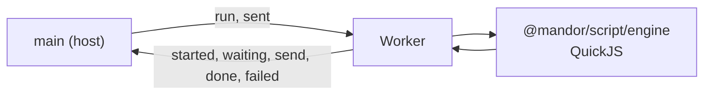

# `@mandor/script`

Corre el texto de un script de usuario en QuickJS (WASM) y devuelve una cadena. No toca disco, red ni git: el script no ve nada que el paquete no le haya puesto a mano. Es la mitad pura de los scripts; el Worker que lo aloja y el puente con el resto de la app viven en `host`.

## Arquitectura

El barril `@mandor/script` es lo que main y la ventana leen sin cargar el motor:

- el esquema zod de los mensajes entre main y el Worker (`run`, `started`, `waiting`, `send`, `sent`, `done`, `failed`, todos con `runId`);
- la entrada y la salida de una corrida (`scriptRunInputSchema`, `scriptRunOutputSchema`, efectos y eventos) y `clampOutput`, que la recorta a sus topes;
- `SCRIPT_LIMITS` (tiempo, memoria, bytes de salida, Workers a la vez);
- la API que ve un script por evento (`API_BY_EVENT`, `SCRIPT_API`);
- los caracteres ocultos de un texto (`hiddenCharactersIn`, `visibleName`), para la confianza.

El motor sale por la subruta `@mandor/script/engine` y solo lo carga `serve-scripts.ts` de `host`, dentro del Worker.



Los topes los pone el motor: la memoria del WASM tiene un máximo, el reloj del invitado alimenta el manejador de interrupción y la recursión y el bucle se cortan. Lo que el manejador no alcanza (una función nativa larga) lo corta main con su propio reloj y `terminate`.

## Fronteras

Lo comprueban `npm run depcruise` y `npm run lint`:

- `quickjs-lives-in-script`: solo este paquete importa `quickjs-emscripten-core` y las variantes `@jitl/quickjs-*`.
- `engine-loads-only-in-the-worker`: nadie importa `src/engine/` salvo el Worker de `host` y los tests.
- `node-vm-is-no-sandbox`: nadie importa `vm`, `node:vm` ni `vm2`.
- `no-eval`, `no-new-func` y `no-implied-eval`: ningún texto se evalúa fuera del motor.

## Comandos

```bash
npm run ci:test -- packages/script
```
