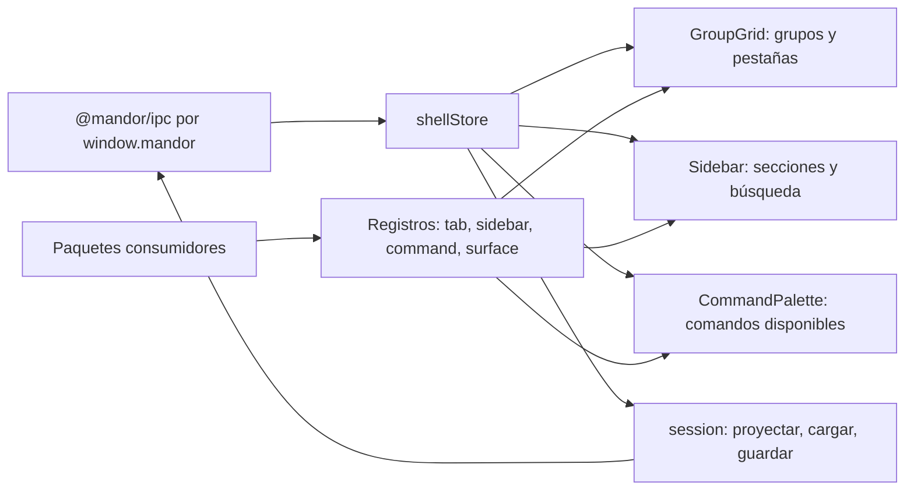

# `@mandor/shell`

Base compartida de la ventana: organiza pestañas en grupos, barra lateral, comandos, atajos, búsqueda y sesión. Ofrece registros para que otros paquetes aporten contenido sin que el shell conozca cada función del producto.

## Arquitectura

El centro es `shellStore`, un store de Zustand sin componentes React. Su estado combina origen activo, espacio activo, árbol de grupos, pestañas, paneles y un índice de recursos. `GroupGrid`, `Sidebar`, `CommandPalette` y el resto de componentes leen ese estado. La mayoría de piezas son funciones y tipos; las clases `ShortcutConflictError` y `SidebarSearchTakenError` representan fallos de registro, no una jerarquía de dominio.



El árbol de grupos vive en `grid/`. Cada hoja tiene pestañas y una pestaña activa. Las operaciones de `shellStore` abren, cierran, mueven y ordenan pestañas; dividen, enfocan o cierran grupos. `grid-changes.ts` calcula un nuevo layout. `resource-index.ts` reconstruye qué pestañas miran cada URI de recurso y conserva la marca de recurso ausente. `GroupGrid` traduce ese modelo a Dockview.

Los registros son puntos de extensión. Un tipo de pestaña se declara en el árbol con `<TabKind>`: su lógica va en props y lo que pinta, como hijos (`TabBody`, `TabIndicator`, `TabStatus`). Una sección del lateral se declara igual, con `<SidebarSection>` y sus partes `SidebarSectionBody` y `SidebarSectionActions`; el orden lo elige el consumidor. El buscador, con `<SidebarSearch>`, `SidebarSearchField` y `SidebarSearchResults`. `registerCommand` declara una acción; `availableCommands` la ofrece cuando su condición se cumple. `registerSurface` conecta comandos con lugares de la ventana. Registros de búsqueda, acciones del extremo de pestaña, grupos vacíos y movimientos de recursos siguen el mismo patrón: registrar devuelve la función para retirar exactamente esa contribución.

`shellStore` no contiene los datos de un documento, entorno o elemento. Mantiene solo lo común a la ventana y una URI para cada recurso. El paquete depende de `@mandor/ipc` y `@mandor/schema` para contratos y recursos, de `@mandor/ui`, `@mandor/icons` y `@mandor/i18n` para interfaz, y de React, Zustand y Dockview para presentación y estado.

Archivos clave: [`src/shell-store.ts`](src/shell-store.ts), [`src/shell-data.ts`](src/shell-data.ts), [`src/grid/`](src/grid/), [`src/tab/`](src/tab/), [`src/sidebar/`](src/sidebar/), [`src/command/`](src/command/) y [`src/session/`](src/session/).

## Uso y cambios

### Aportar una pestaña

Registra un `TabKind` con su forma de renderizar y liberar recursos. Después abre la pestaña mediante `shellStore`; el shell la coloca en un grupo, conserva la URI del recurso y programa guardar la sesión. `GroupGrid` consulta el registro para dibujarla. Si un archivo cambia de ruta, llama `moveResource(from, to)` para que las pestañas y los oyentes del recurso actualicen su estado.

### Aportar navegación o comandos

Las secciones laterales y las superficies se registran desde el paquete que las implementa. Los comandos también se registran: el shell reúne atajos, paleta y menús a partir de esos registros. Conserva siempre la función de limpieza, porque una ventana puede desmontar una sección o cambiar de contexto sin reiniciar el proceso.

### Seguir el estado

[`shell-store.ts`](src/shell-store.ts) guarda grupos, pestañas y selección; [`src/tab/`](src/tab/) define registros y ciclo de vida; [`src/session/`](src/session/) proyecta y guarda la sesión. [Flujos](#flujos) explica apertura, movimiento de recursos y persistencia. Si agregas estado, decide si pertenece a la sesión antes de incluirlo en la proyección. Las pruebas de [`tests/`](tests/) cubren store, grupos, pestañas y sesión.

### Ciclo de una pestaña

[`TabKind`](src/components/tab-kind/TabKind.tsx) declara `id`, icono, título y si se puede cerrar, y lleva como hijos el cuerpo, el indicador y el estado de la pestaña. Puede añadir `holds` para comprobar un recurso antes de abrirlo, `release` para liberar recursos vivos al cerrar, y `subscribeTitles` si su nombre cambia fuera del recurso. Declara en un efecto de layout, antes de que la sesión restaure pestañas, y al desmontarse retira exactamente su declaración. Dentro de una pestaña, `useTab()` da su `resource` y su `tabId`.

`shellStore` guarda la disposición y un índice de URIs. Cuando un recurso cambia de nombre, `moveResource` actualiza las pestañas y avisa a los paquetes que registraron un oyente. Al cerrar una pestaña, `release` libera su socket o buffer; el archivo que mostraba permanece en disco. [`createSessionSaver`](src/session/debounced-session-save.ts) espera 250 ms entre cambios y permite `flush` para guardar antes de cambiar de origen.

Una contribución nueva suele tener tres piezas: registro del tipo o sección, componente que lee su estado propio, y función de limpieza. El shell administra la ventana; cada paquete conserva sus datos de dominio.

## API pública

Importa estas exportaciones desde `@mandor/shell`. La API del paquete está definida en [`src/index.ts`](src/index.ts). Un registro devuelve una función que se ejecuta al desmontar la contribución.

### Estado, recursos y sesión

| Exportaciones                                                                               | Contrato                                                                                                                |
| ------------------------------------------------------------------------------------------- | ----------------------------------------------------------------------------------------------------------------------- |
| `bridge`                                                                                    | Única lectura de `window.mandor`, la superficie `CoreBridge` que expone preload.                                        |
| `shellStore`, `ShellStore`                                                                  | El store de la ventana. Acciones de pestañas, grupos, origen, espacio, paneles y sesión.                                |
| `useShellStore(selector)`                                                                   | Suscribe un componente React a una parte del store compartido.                                                          |
| `selectActiveGroup`, `selectActiveTabId`, `selectGroupOfTab`, `selectSection`, `selectTabs` | Selectores del estado: grupo, pestaña activa, ubicación de una pestaña, sección de recurso y pestañas del grupo activo. |
| `Tab`                                                                                       | Una pestaña abierta: id, tipo, recurso y si está fijada o en vista previa.                                              |
| `originName()`                                                                              | Nombre del origen activo usado al formar URIs; usa el ID o `local` como respaldo.                                       |
| `movedResource(resource, from, to)`                                                         | Calcula la nueva URI tras renombrar un recurso o una carpeta que lo contiene.                                           |
| `registerResourceMove(listener)`                                                            | Escucha cambios de URI anunciados por el shell y devuelve la baja del oyente.                                           |
| `saveOnClose(store?)`                                                                       | Escucha `pagehide`, envía las ediciones que esperan su pausa y la sesión, y devuelve cómo retirar el listener.          |
| `createPendingWrites(write)`                                                                | Espera la pausa de la escritura, una por clave; `flush` y `flushWhere` la envían ya.                                    |
| `settlePendingWrites()`                                                                     | Envía ya toda edición que espera su pausa, de todo tipo; lo llaman el cierre y el cambio de origen.                     |
| `createLatestRead()`                                                                        | Turno de las lecturas que se reemplazan en pantalla: solo la última pedida escribe su respuesta.                        |
| `fireAndForget(request)`                                                                    | Suelta una promesa que la ventana no espera: si se rechaza, va al registro y no a la consola. Sin promesa, nada.        |
| `selectResourceOfTab(state, tabId)`                                                         | El recurso que mira una pestaña, esté en el grupo que esté; `null` si no está abierta.                                  |
| `scopeToOrigin(store)`, `onOriginLeft(callback)`, `dropOriginState()`                       | Marcan lo que alimentó el origen abierto: cada store vuelve a su estado inicial y cada callback corre al dejarlo.       |
| `useKeepTab()`                                                                              | Conserva la pestaña en la que se pinta la pieza; fuera de una pestaña no hace nada.                                     |

### Pestañas, grupos y barra lateral

| Exportaciones                                                                           | Contrato                                                                                                             |
| --------------------------------------------------------------------------------------- | -------------------------------------------------------------------------------------------------------------------- |
| `TabKind`, `TabBody`, `TabIndicator`, `TabStatus`, `useTab()`                           | Declaran en el árbol un tipo de pestaña y lo que pinta; `useTab()` lee la pestaña desde dentro.                      |
| `tabKind(id)`, `tabKindOf(id)`                                                          | Leen fuera de React el tipo declarado. `tabKind` puede devolver `undefined`; `tabKindOf` lanza error si falta.       |
| `TabStripAction`, `useTabStrip()`                                                       | Declara en el árbol una acción junto a las pestañas de cada tira; `useTabStrip()` lee el grupo desde dentro.         |
| `EmptyGroup`                                                                            | Declara en el árbol el contenido de un grupo sin pestañas.                                                           |
| `StatusItem`, `useStatusItems()`, `NoticeCenterItem`                                    | Declaran en el árbol una pieza de la barra de estado con `id` y `order`; el centro de avisos es una de ellas.        |
| `useDeclaration(declarations, logic, part, node)`                                       | Declara una pieza de una sola parte mientras el componente que la llama sigue montado.                               |
| `createDeclarations()`, `Declared`, `useDeclared`, `useDeclaredList`, `useDeclaredPart` | Un registro de declaraciones: lo que decide cada una y sus partes, leídas de una en una o todas en orden de llegada. |
| `TabProvider`                                                                           | Da la pestaña a quien pinta una parte de un tipo: el grupo, la tira o una prueba.                                    |
| `UnsavedChangesDialog`                                                                  | La pregunta de una pestaña con trabajo sin guardar al cerrarla a mano.                                               |
| `SidebarSection`, `SidebarSectionBody`, `SidebarSectionActions`                         | Declaran en el árbol una sección lateral con `id`, `order`, icono y título; el cuerpo y las acciones son hijos.      |
| `useResourceSection(resource, fallback)`                                                | Lee y cambia la sección interna asociada a una URI, aunque su pestaña cambie de grupo.                               |
| `GroupGrid`, `Sidebar`, `SidebarResizer`                                                | Cuadrícula de grupos, barra lateral y control de ancho.                                                              |
| `StatusLine`, `OriginSwitching`                                                         | Línea de estado y aviso durante cambio de origen.                                                                    |
| `AppIcon`, `AppMenuButton`, `WindowControls`                                            | Piezas del encabezado de ventana.                                                                                    |

### Comandos y atajos

| Exportaciones                                                                             | Contrato                                                                                                         |
| ----------------------------------------------------------------------------------------- | ---------------------------------------------------------------------------------------------------------------- |
| `registerCommand(command)`, `registeredCommands()`, `availableCommands(state)`, `Command` | Declara una acción con `id`, `run`, icono, categoría y título. `when` controla si aparece entre los disponibles. |
| `registerShellCommands()`                                                                 | Registra los comandos del shell y devuelve su baja.                                                              |
| `registerSurface(surface)`, `windowSurface(id)`                                           | Conecta un comando con un lugar de la ventana sin que el shell importe su contenido.                             |
| `CommandPalette`                                                                          | La paleta de comandos de la ventana.                                                                             |
| `DEFAULT_SHORTCUTS`, `useShortcuts(shortcuts?)`                                           | Tabla y escucha de atajos. `window` ignora escritura en campos; `editing` sigue activo dentro de ellos.          |
| `shortcutLabel(combination, apple)`, `isApplePlatform()`                                  | Forma la etiqueta de un atajo y detecta macOS.                                                                   |
| `useMenuEditSteps()`, `useMenuLanguage()`                                                 | Conectan el menú del proceso principal con edición e idioma del renderer.                                        |

### Búsqueda lateral

| Exportaciones                                                                            | Contrato                                                                                                           |
| ---------------------------------------------------------------------------------------- | ------------------------------------------------------------------------------------------------------------------ |
| `SearchEntry`, `SearchField`, `WorkspaceEntries`                                         | Una entrada buscable, su campo coincidente y el proveedor de entradas de un espacio.                               |
| `SidebarSearch`, `SidebarSearchField`, `SidebarSearchResults`, `useSidebarSearchField()` | Declaran el único buscador lateral con su longitud mínima; el campo lee con el hook la caja que el lateral enfoca. |
| `focusSidebarSearch()`                                                                   | Enfoca el campo de búsqueda montado.                                                                               |
| `setSidebarSearchQuery(query)`, `useSidebarSearchQuery()`                                | Escriben y leen el texto de búsqueda.                                                                              |

### Choques y avisos

| Exportaciones                                                                              | Contrato                                                                                                           |
| ------------------------------------------------------------------------------------------ | ------------------------------------------------------------------------------------------------------------------ |
| `selectConflicts`, `selectConflictFor(state, entity)`                                      | La lista de choques del origen y el choque del que forma parte una entidad.                                        |
| `openConflict(conflict)`                                                                   | Muestra un choque en el centro desde donde se notó; una pestaña por choque.                                        |
| `conflictResource(origin, workspaceId, id)`, `conflictTabId(id)`, `conflictIdOf(resource)` | La URI de un choque, el id de su pestaña y el id de vuelta desde la URI.                                           |
| `SyncNotice`, `syncNoticeOf(state)`                                                        | Lo que la ventana dice de la sincronización del origen abierto: funciona, falló o chocó; `null` se lee como listo. |
| `NoticeFeed`, `recordNotice(request)`                                                      | Dice lo que main levanta por su cuenta y guarda cada aviso en el centro cuando el toast ya se fue.                 |
| `useFailureToast()`                                                                        | Cuenta un fallo con un toast en las palabras de su código; el mensaje queda en el log.                             |
| `useRepoChanged(match, onChange)`                                                          | Llama a `onChange` con las entidades que cambiaron en disco sin la ventana y que la vista muestra.                 |

### Fallos y arranque

| Exportaciones                               | Contrato                                                                                                                                   |
| ------------------------------------------- | ------------------------------------------------------------------------------------------------------------------------------------------ |
| `FaultBoundary`                             | Encierra lo que lanza un componente en la región que pintaba; el resto de la ventana sigue.                                                |
| `rootErrorOptions`, `watchRendererFaults()` | Las puertas de error de la raíz React y lo que ningún límite ve (manejadores, temporizadores, promesas sin `catch`); todo acaba en el log. |
| `useWindowReady()`                          | Avisa a main, una vez, de que la ventana pintó lo restaurado; main anota el momento en el log del arranque.                                |

Ejemplo de declaración:

```tsx
import { SidebarSection, SidebarSectionBody } from '@mandor/shell';

<SidebarSection icon="folder" id="example" order={20} title="example:heading">
    <SidebarSectionBody>
        <p>Contenido</p>
    </SidebarSectionBody>
</SidebarSection>;
```

Mientras el elemento está montado, la sección existe; al desmontarse, desaparece.

### Subrutas

`@mandor/shell/grid.css` aporta estilos de la cuadrícula. Las subrutas `testing` son ayudantes de pruebas; no forman parte del flujo de la interfaz.

| Subruta                           | Exportaciones                                        | Para qué                                                                                                  |
| --------------------------------- | ---------------------------------------------------- | --------------------------------------------------------------------------------------------------------- |
| `@mandor/shell/testing`           | `dragTabOnto`, `DropSide`                            | Arrastrar una pestaña sobre un lado de un grupo.                                                          |
| `@mandor/shell/testing/grid`      | `splitAndRestore`                                    | Divide el grupo inicial y cierra la división; devuelve cuántos grupos quedaron tras cada paso.            |
| `@mandor/shell/testing/sidebar`   | `SidebarHeader`                                      | La cabecera del lateral sin el lateral: la caja que alcanza el campo de un buscador probado solo.         |
| `@mandor/shell/testing/tab-kind`  | `declareTabKindSpec`, `DrawnTabPart`, `translatorIn` | Declarar un tipo de pestaña sin el árbol, leer su título en un idioma y pintar una de sus partes.         |
| `@mandor/shell/testing/tab-strip` | `TabStripOf`, `TabOf`                                | La tira de un grupo sin la rejilla, para probar una acción sola, y una pestaña con el nombre que anuncia. |

## Flujos

### Pestaña y grupo

Un consumidor registra su `TabKind` y llama `shellStore.getState().openTab(groupId, tab)`. El store calcula el nuevo árbol, actualiza el índice de recursos y programa guardar la sesión. `GroupGrid` dibuja la pestaña mediante el `render` del tipo registrado. Al cerrar una pestaña, el shell llama su `release` antes de quitarla del árbol. `openTabAside` abre en un grupo vecino o divide el actual si hace falta. Las acciones de grupo comparten ese camino de actualización y guardado.

### Recurso renombrado o borrado

Un paquete que renombra un archivo llama `moveResource(from, to)`. El shell cambia las URIs de las pestañas y avisa a los oyentes registrados con `registerResourceMove`, para que cada paquete mueva su propio estado asociado al recurso. `removeResource(resource)` conserva pestañas abiertas pero marca su recurso como ausente. `movedResource` sirve para cambiar una URI exacta o una ruta descendiente de una carpeta.

### Sesión

Los cambios persistentes llaman `createSessionSaver`: esperan 250 ms antes de enviar `session.save` por el bridge. `flushSession()` cancela la espera y aguarda la respuesta, útil antes de cambiar de origen. `loadSession(originId)` restaura el layout de ese origen. `saveOnClose()` escucha `pagehide` y envía el estado final, con las ediciones que aún esperan su pausa. Estado temporal como pestaña en renombrado, sección interna de un recurso o grupo maximizado no forma parte de la sesión proyectada.

Pruebas dirigidas: [`tests/store/`](tests/store/), [`tests/grid/`](tests/grid/), [`tests/session/`](tests/session/), [`tests/tab/`](tests/tab/) y [`tests/resource/`](tests/resource/).
