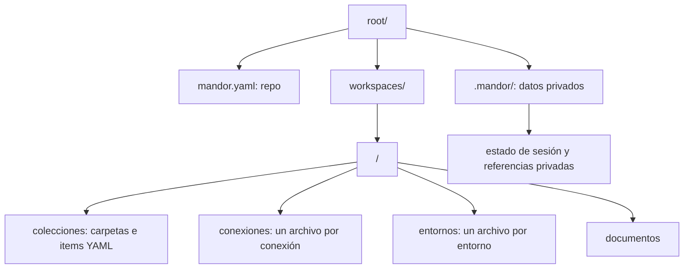
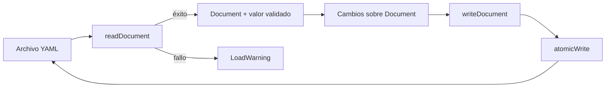

# @mandor/store-fs

Lee y escribe datos del repositorio en archivos. Convierte YAML en modelos validados de @mandor/schema, conserva comentarios y campos desconocidos, y observa cambios externos. Las operaciones de entidad reciben una ruta raíz; las primitivas de disco reciben rutas de archivo.

## Arquitectura

El paquete organiza archivos por entidad. Las operaciones construyen rutas a partir de `root` y delegan validación de datos a `@mandor/schema`.



Las funciones de ruta en `repo/`, `workspace/`, `collection/`, `connection/`, `environment/`, `doc/` y `session/` son la fuente exacta de los nombres y ubicaciones. El esquema anterior muestra responsabilidades, no sustituye esas funciones. `writeRepoTree` prepara `.gitignore` para excluir `.mandor/` y `.gitattributes` para finales de línea consistentes.

### Lectura y escritura de un archivo



`readDocument(path, parse)` devuelve un resultado discriminado. `readOrThrow` sirve cuando un error debe detener la operación. `writeDocument(path, document, changes)` modifica solo las claves indicadas; `undefined` borra una clave. Así una edición no descarta comentarios ni campos que otro consumidor entiende. `watchRepo(root, onBatch)` entrega rutas y tipo de cambio, omite `.git` y `.mandor`, agrupa eventos cercanos y devuelve `RepoWatcher.dispose()` para liberar el observador.

Al guardar un entorno, `writeEnvironment` y `updateEnvironment` entregan secretos a `SecretKeeper` antes de cambiar el archivo. El archivo recibe variables sin su valor secreto. Si el guardado externo falla, el archivo anterior permanece. El paquete conoce ese contrato, pero no el almacén de secretos concreto. `FileReadError` y `NameTakenError` son clases de error; la persistencia y las operaciones de entidad son funciones.

### Para contribuir

Dependencias de ejecución: `@mandor/schema` y `yaml`, además de API de archivos de Node. Comienza por [`src/disk/read-document.ts`](src/disk/read-document.ts) y [`src/disk/write-document.ts`](src/disk/write-document.ts) si cambias formato o persistencia; sigue la carpeta de la entidad para operaciones concretas. [`tests/`](tests/) repite las áreas del código (`collection`, `connection`, `disk`, `environment`, `repo`, `workspace`, etc.). Pruebas dirigidas: `npm run ci:test -- packages/store-fs` desde la raíz.

## Uso y cambios

### Leer y cambiar datos

Las operaciones de entidad reciben `root`, la carpeta raíz del repositorio de datos. La carpeta de cada entidad (`repo`, `workspace`, `collection`, `connection`, `environment`, `doc` o `session`) calcula su ruta y usa las primitivas de [`src/disk/`](src/disk/). `readDocument` conserva el documento YAML junto al valor validado. `writeDocument` cambia las claves solicitadas sobre ese documento: así quedan los comentarios y los campos ajenos a la operación.

Para una lectura recuperable, examina el resultado y su `LoadWarning`. Para una operación que debe detenerse si falla, usa la variante `readOrThrow`. Las escrituras pasan por `atomicWrite`; `watchRepo` agrupa cambios externos y requiere `dispose()` cuando deja de observarse.

### Seguir un cambio de formato

Primero actualiza la entidad y validación de `@mandor/schema`. Luego cambia la función de lectura o escritura de su carpeta en [`src/`](src/) y prueba un archivo existente con comentarios y campos desconocidos. En entornos, la escritura de secretos usa `SecretKeeper`; revisa esa frontera antes de modificar la forma del YAML. [`tests/`](tests/) tiene casos por entidad y por primitiva de disco.

### Garantías del formato en disco

[`readDocument`](src/disk/read-document.ts) devuelve `{ ok: true, document, value }` o `{ ok: false, warning }`. Mantiene el árbol YAML original junto al dato validado. [`writeDocument`](src/disk/write-document.ts) cambia solo las claves indicadas: omitir una clave significa conservarla; poner `undefined` significa borrarla. Escribe con dos espacios y sin envolver líneas, mediante `atomicWrite`.

Esta regla permite que dos consumidores de un mismo archivo conserven comentarios, orden y campos que el otro no entiende. Al editar un modelo persistido, evita convertir todo el documento a objeto y serializarlo de nuevo. Los secretos de entornos se entregan a `SecretKeeper` y el YAML recibe variables sin valor secreto; la implementación concreta del almacén llega por parámetro.

`watchRepo` omite datos privados y `.git`, agrupa cambios cercanos y entrega rutas afectadas. Quien inicia el observador conserva `dispose()` para liberar recursos. Las pruebas de [`tests/disk/`](tests/disk/) son la referencia para preservar archivos existentes.

## API pública

Consulta [`src/index.ts`](src/index.ts) para la lista de exportaciones. Estas son las herramientas, agrupadas por el dato que manejan:

| Área                  | Exportaciones                                                                                                                                                                                                                                                                                          | Resultado o efecto                                                                                                                                                                                                                 |
| --------------------- | ------------------------------------------------------------------------------------------------------------------------------------------------------------------------------------------------------------------------------------------------------------------------------------------------------ | ---------------------------------------------------------------------------------------------------------------------------------------------------------------------------------------------------------------------------------- |
| Repositorio           | `loadRepo`, `writeRepoTree`, `emptyRepo`, `entityOfPath`; `repoFile`, `mandorDir`                                                                                                                                                                                                                      | Carga, prepara o vacía el repositorio. `loadRepo` devuelve `repo`, `workspaces` y `warnings`; si falla el archivo raíz, `repo` es `null`. `entityOfPath` dice qué entidad es un archivo del repo, para el vigilante y los choques. |
| Espacios              | `createWorkspace`, `readWorkspace`, `listWorkspaces`, `renameWorkspace`, `deleteWorkspace`, `writeWorkspaceVariables`, `variablesTextWith`, `writeImportedWorkspace`; `workspaceDir`, `workspaceFile`                                                                                                  | Administra el contenedor, sus variables y lo que una importación escribe en él. `createWorkspace` agrega su id al orden del repositorio.                                                                                           |
| Colecciones: consulta | `readCollectionsFile`, `readCollectionFile`, `readFolder`, `readItem`, `readCollectionTree`, `collectionDir`, `collectionsFile`, `collectionDefinitionFile`, `folderDir`, `folderFile`, `itemFile`                                                                                                     | Lee datos individuales o un árbol de nombres y orden. El árbol no carga el `body` de los items; un item ilegible produce aviso. Una colección sin archivo sigue existiendo: manda el directorio.                                   |
| Colecciones: edición  | `createCollection`, `createCollectionFolder`, `NewCollectionFolder`, `createCollectionItem`, `writeCollectionFile`, `writeFolder`, `writeItem`, `itemTextWith`, `moveCollectionNode`, `reorderCollectionNode`, `renameFolder`, `renameItem`, `removeCollectionNode`, `NameTakenError`, `RootItemError` | Crea, edita, mueve, reordena, renombra y elimina nodos. `writeItem` conserva claves y comentarios existentes. La raíz solo guarda colecciones: un item ahí es `RootItemError`.                                                     |
| Importación           | `writeImportedCollection`, `writeImportedFolder`, `writeImportedWorkspace`                                                                                                                                                                                                                             | Escriben lo que trae una importación junto al origen que lo firmó, en una sola escritura: un corte entre las dos dejaría una auth sin dueño.                                                                                       |
| Autenticación         | `readAuthChain`, `writeAuth`                                                                                                                                                                                                                                                                           | Los niveles de auth de un lugar, del más cercano al espacio; escribir la de una carpeta, colección o espacio. `null` quita la clave y el nivel vuelve a heredar.                                                                   |
| Conexiones            | `createConnection`, `listConnections`, `readConnection`, `updateConnection`, `ConnectionPatch`, `connectionTextWith`, `deleteConnection`, `connectionFile`                                                                                                                                             | Un archivo por conexión, con id generado desde los ids presentes en disco.                                                                                                                                                         |
| Entornos              | `readEnvironment`, `writeEnvironment`, `updateEnvironment`, `EnvironmentPatch`, `environmentTextWith`, `deleteEnvironment`, `listEnvironments`, `environmentFile`, `readActiveEnvironments`, `writeActiveEnvironments`, `keepSecrets`, `SecretKeeper`                                                  | Guarda variables y la selección de entornos activos. `SecretKeeper` lo aporta el consumidor; `keepSecrets` entrega cada secreto antes de reescribir un byte del archivo.                                                           |
| Choques               | `conflictId`, `writeConflict`, `listConflicts`, `removeConflict`                                                                                                                                                                                                                                       | Un registro por archivo en choque, dentro de `.mandor`, con id derivado de su ruta: un segundo choque del mismo archivo reemplaza al primero.                                                                                      |
| Historial y cuerpos   | `historyDir`, `historyEntryFile`, `historyFileName`, `historyFileNames`, `listHistory`, `readHistoryFiles`, `readHistoryEntry`, `historyToPrune`, `orphanBodies`, `removeHistoryEntries`, `removeHistoryFiles`; `bodiesDir`, `bodyFile`, `removeBodies`                                                | Entradas del historial de Request, su poda por edad y cantidad, y los cuerpos grandes guardados por su sha-256, que solo se borran cuando ninguna entrada los nombra. Todo dentro de `.mandor`.                                    |
| Documentos y sesión   | `createDoc`, `listDocs`, `readDoc`, `writeDoc`, `renameDoc`, `docFile`, `docRepoPath`, `docsDir`; `readSession`, `writeSession`                                                                                                                                                                        | Maneja archivos de texto y estado de sesión.                                                                                                                                                                                       |
| Archivos locales      | `cookieJarFile`, `graphqlSchemaDir`, `graphqlSchemaFile`                                                                                                                                                                                                                                               | El tarro de cookies de un entorno y los esquemas GraphQL leídos, dentro de `.mandor`: una cookie de sesión vale lo que una contraseña.                                                                                             |
| Primitivas de disco   | `readOrThrow`, `readTextOrNull`, `documentOf`, `atomicWrite`, `fileExists`, `FileReadError`, `LoadWarning`, `watchRepo`, `RepoWatcher`, `DiskChange`                                                                                                                                                   | Lectura validada, edición YAML, escritura atómica y aviso de cambios externos.                                                                                                                                                     |

Ejemplo de lectura: `root` es la carpeta elegida por el consumidor.

```ts
import { loadRepo } from '@mandor/store-fs';

async function inspect(root: string) {
    const loaded = await loadRepo(root);
    if (loaded.repo === null) {
        console.log(loaded.warnings);
    }
}
```
