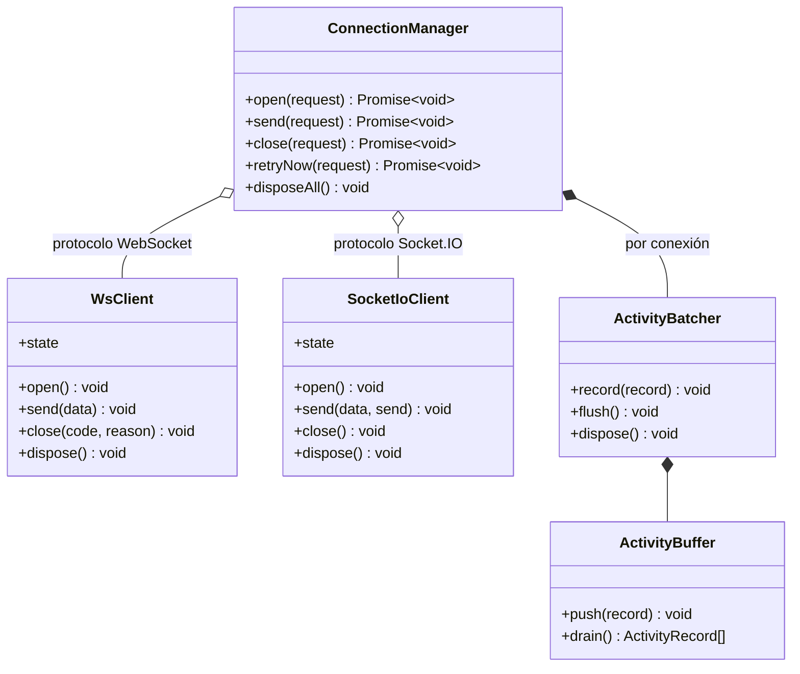

# `@mandor/transport-async`

Biblioteca para abrir conexiones WebSocket y Socket.IO, enviar mensajes y recibir estados y actividad. `ConnectionManager` coordina varias conexiones; los clientes de cada protocolo solo manejan su socket. Ninguno conoce una app, una ventana o IPC.

## Arquitectura

El paquete separa protocolo, política de conexión y registro de actividad. `ConnectionManager` guarda una conexión por `connectionId` y escoge `WsClient` o `SocketIoClient` según `transport`. Ambos cumplen las operaciones de `AsyncClient`: `open`, `send`, `close`, `dispose` y estado actual.



`WsClient` usa `ws` para enviar texto o bytes. Puede activar ping/pong con `startKeepalive`; un pong que vence termina el socket. `SocketIoClient` usa `socket.io-client`; los mensajes viajan como eventos con nombre y la reconexión automática de esa biblioteca está desactivada. El gestor aplica una sola política de reintentos a ambos protocolos.

Cada mensaje produce un `ActivityRecord` con dirección, fecha, contenido y, cuando procede, evento, origen y relación con un acuse de recibo. [`activity-record.ts`](src/activity/activity-record.ts) convierte bytes a base64 y marca `binary: true`. `ActivityBatcher` evita emitir un evento por cada mensaje: vacía el lote por tamaño o tiempo. `ActivityBuffer` pone límite a memoria y cuenta los registros antiguos que descarta. Valores por defecto del gestor: lote de 100 registros, ventana de 50 ms y buffer de 1 000; [`ConnectionManagerOptions`](src/manager/connection-manager.ts) permite cambiarlos.

### Archivos clave

- [`manager/connection-manager.ts`](src/manager/connection-manager.ts): operaciones públicas y eventos.
- [`manager/live-connection.ts`](src/manager/live-connection.ts): estado y recursos de una conexión.
- [`manager/reconnect-policy.ts`](src/manager/reconnect-policy.ts): espera exponencial y límite de intentos.
- [`manager/ack-waiting.ts`](src/manager/ack-waiting.ts): temporizadores de respuestas esperadas.
- [`client/`](src/client/) y [`activity/`](src/activity/): protocolos y registros.

El paquete depende de `ws` y `socket.io-client`. Sus tipos tienen la forma de las solicitudes y eventos que consume el host, pero no importa `@mandor/host` ni `@mandor/ipc`. El consumidor conecta ambas bibliotecas.

## Uso y cambios

### Usar el gestor

`ConnectionManager` es la entrada cuando hay varias conexiones, reintentos y registros de actividad. Recibe callbacks `onState` y `onActivity`; `open`, `send`, `close` y `disposeAll` gobiernan su ciclo. Por dentro, `WsClient` y `SocketIoClient` hablan cada protocolo con la forma de `AsyncClient`; el paquete no los exporta.

`ConnectionManager` conserva una `LiveConnection` por ID y crea el cliente correspondiente al transporte. `ActivityBatcher` reúne registros; `ActivityBuffer` limita cuántos permanecen pendientes. `ReconnectPolicy` calcula esperas después de cortes involuntarios. Estas piezas están separadas para que el consumidor no tenga que gestionar temporizadores, protocolos y lotes a la vez.

### Seguir un envío

Comienza en [`connection-manager.ts`](src/manager/connection-manager.ts), sigue el cliente de [`src/client/`](src/client/) y vuelve a [`src/activity/`](src/activity/) para ver el registro emitido. Si el envío espera acuse, [`ack-waiting.ts`](src/manager/ack-waiting.ts) controla plazo y respuesta. [Flujos](#flujos) explica la secuencia y las condiciones de reintento. Para cambiar un transporte, prueba apertura, fallo, cierre y actividad en [`tests/`](tests/).

### Contrato de `ConnectionManager`

El constructor recibe `onState` y `onActivity`, y permite cambiar tamaño de lote (100), ventana de emisión (50 ms) y buffer máximo (1 000). `open` reemplaza una conexión con el mismo ID y espera el estado `open`; si el socket se cierra antes, su promesa falla. `send` requiere una conexión conocida y abierta: usa `ConnectionManagerError` para ID desconocido y `WsClientError` para estado incorrecto.

`close` marca cierre solicitado, cancela reintento y acuses pendientes, vacía actividad, quita la conexión del mapa y cierra el cliente. Cerrar un ID ausente termina sin error. `disposeAll` libera todos los clientes, lotes y temporizadores. Estos métodos delimitan el ciclo; no hace falta manipular `WsClient` desde el consumidor del gestor.

Los reintentos se programan solo si la conexión llegó a abrirse y luego se cortó sin petición de cierre. `reconnectDelay` duplica la espera por intento, la limita al techo y aplica una variación configurable. `retryNow` adelanta únicamente un reintento ya pendiente.

## API pública

Importa desde `@mandor/transport-async`, cuyo barril es [`src/index.ts`](src/index.ts). Las solicitudes de `open`, `send` y `close` son tipos de los parámetros de `ConnectionManager`, no exports propios.

| Área                 | Exports             | Para qué sirven                                                   |
| -------------------- | ------------------- | ----------------------------------------------------------------- |
| Gestión              | `ConnectionManager` | Gestionar varios sockets y comunicar estado y lotes de actividad. |
| Mensajes y actividad | `ActivityRecord`    | Cada registro de actividad que el gestor entrega en lotes.        |
| Validación           | `assertSocketUrl`   | Validar la URL contra los esquemas del transporte.                |
| Errores              | `SocketOpenError`   | Socket cerrado antes de abrir, con su motivo.                     |

`OpenConnectionRequest` exige `connectionId`, `transport` (`websocket` o `socketio`) y `url`. Puede incluir encabezados, subprotocolos, certificado, keepalive, reconexión y opciones Socket.IO. `SendConnectionRequest` exige `connectionId` y `data`; Socket.IO también exige `event`. `expectAck` añade un plazo para la respuesta. `schemaUnmet` marca un envío que no cumplió el esquema que su llamador comprobó.

```ts
import { ConnectionManager } from '@mandor/transport-async';

const manager = new ConnectionManager({
    onState: (push) => console.log(push.connectionId, push.state),
    onActivity: (push) => console.log(push.records),
});

await manager.open({
    connectionId: 'uno',
    transport: 'websocket',
    url: 'wss://example.test',
});
await manager.send({ connectionId: 'uno', data: 'hola' });
await manager.close({ connectionId: 'uno' });
manager.disposeAll();
```

`assertSocketUrl` acepta `ws:`/`wss:` para WebSocket y `http:`/`https:` para Socket.IO; rechaza credenciales incrustadas. Consulta [`tests/manager/connection-manager.test.ts`](tests/manager/connection-manager.test.ts), [`tests/manager/connection-manager-reconnect.test.ts`](tests/manager/connection-manager-reconnect.test.ts) y [`tests/client/socketio-client.test.ts`](tests/client/socketio-client.test.ts) para ver casos de uso y errores.

## Flujos

```mermaid
sequenceDiagram
    participant C as Consumidor
    participant M as ConnectionManager
    participant S as Cliente de protocolo
    participant A as ActivityBatcher
    C->>M: open(OpenConnectionRequest)
    M->>S: open()
    S-->>M: estado open
    M-->>C: onState; promesa resuelta
    C->>M: send(SendConnectionRequest)
    M->>S: send(data)
    M->>A: record(salida)
    S-->>M: mensaje recibido
    M->>A: record(entrada)
    A-->>C: onActivity(lote)
```

**Apertura.** `open` crea una conexión identificada por `connectionId`. La promesa se resuelve cuando el cliente informa `open`; si se cierra antes, falla. Abrir otra conexión con el mismo identificador reemplaza la anterior.

**Envío.** `send` exige una conexión abierta. En Socket.IO el mensaje necesita `event`. Si `expectAck` está presente, el gestor crea un identificador y un temporizador. Una respuesta genera un registro con `replyTo` y `elapsedMs`; si vence, genera uno con `timedOut: true`. Los registros entran en lotes y llegan al consumidor por `onActivity`.

**Corte y reintento.** Un corte involuntario se reintenta solo si la conexión ya se abrió una vez. `DEFAULT_RECONNECT_POLICY` empieza en 500 ms, duplica la espera hasta 8 000 ms, permite cinco intentos y aplica variación aleatoria de 20 %. La solicitud puede sustituir esa política; con `maxAttempts: 0` no reintenta. `retryNow` adelanta un reintento que ya estaba programado.

**Cierre.** `close` marca cierre solicitado, cancela reintentos y acuses pendientes, vacía el lote y quita la conexión del gestor. `disposeAll` libera todos los clientes y temporizadores; úsalo al apagar el proceso. Pruebas: [`connection-manager-acks.test.ts`](tests/manager/connection-manager-acks.test.ts) y [`connection-manager-reconnect.test.ts`](tests/manager/connection-manager-reconnect.test.ts).
