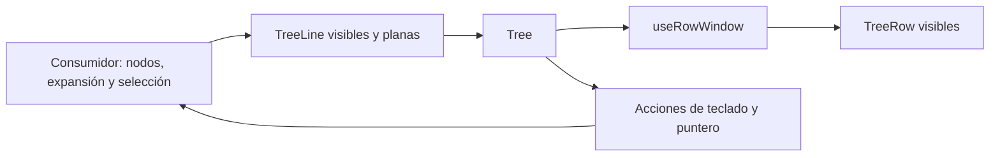
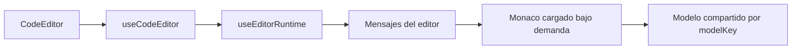

# `@mandor/ui`

Biblioteca de componentes React, estilos y utilidades visuales compartidas. Da controles, estructura de ventana, árboles, diálogos, avisos y un editor de código. El consumidor aporta datos, textos y acciones; el paquete no conoce una app concreta.

## Arquitectura

La biblioteca se organiza por función visual. [`components/`](src/components/) contiene piezas React; [`hooks/`](src/hooks/) conecta componentes con estado compartido; [`editor/`](src/editor/) prepara lenguajes, diagnósticos y Monaco; [`styles/`](src/styles/) define tokens y reglas; [`lib/`](src/lib/) reúne funciones pequeñas que sirven a componentes concretos. No hay clases públicas propias: los componentes son funciones React y el editor se carga por funciones.

```mermaid
flowchart TB
    Tokens[tools/build-tokens.mjs] --> CSS[styles/index.css]
    CSS --> Layout[layout: AppShell, Workbench, paneles]
    CSS --> Controls[button, input, toggle, menu, dialog]
    CSS --> Data[tree, tabs, rows, stack, split]
    CSS --> EditorUI[CodeEditor, SchemaPane, HexView]
    Icons[@mandor/icons] --> Controls
    EditorRuntime[editor/monaco] --> EditorUI
    Toast[ToastProvider y useToast] --> Controls
```

**Controles.** Botones, entradas, selectores, indicadores, menús, diálogos, popovers y tooltips dan comportamiento y estilo reutilizables. Los grupos que funcionan juntos, como `Dialog` con sus partes o `Tabs` con lista y paneles, comparten contexto interno. El consumidor aporta etiquetas y callbacks.

**Estructura y datos.** `AppShell`, `AppBody`, `Workbench`, barras y paneles arman la ventana sin imponer qué contenido se muestra. `Tree` recibe líneas ya aplanadas, selección y acciones; maneja teclado, foco y virtualización, y deja los datos bajo control del consumidor. `SectionStack` y `SplitPane` reparten espacio redimensionable.

**Editor.** `CodeEditor` monta Monaco cuando se necesita. `modelKey` identifica el documento; dos vistas del mismo modelo comparten texto y deshacer. `SchemaPane` coloca payload y esquema lado a lado sin apropiarse de sus textos. `HexView` representa bytes. La carga de Monaco y sus mensajes se hace de forma diferida en [`editor/editor-runtime.ts`](src/editor/editor-runtime.ts).

**Estilos.** `@mandor/ui/styles.css` importa fuentes, Tailwind y variables de diseño. [`tools/build-tokens.mjs`](tools/build-tokens.mjs) genera escalas y módulos TypeScript. [`styles/semantic.css`](src/styles/semantic.css) y [`styles/semantic-dark.css`](src/styles/semantic-dark.css) asignan colores según tema. [`styles/runtime.css`](src/styles/runtime.css) cubre estados que aparecen en tiempo de ejecución; el editor usa el tema de Monaco (`vs` o `vs-dark`) y la fuente mono del producto, y [`styles/editor.css`](src/styles/editor.css) solo pone en cursiva las variables escritas en él. Importa la hoja una vez en la raíz de la interfaz.

Depende de `@mandor/icons` para dibujos y de `@mandor/validate` para diagnósticos del editor. También usa React, Radix, Monaco, Tailwind y bibliotecas de formato y análisis de texto. No importa `@mandor/host`, IPC ni paquetes de una app.

Rutas de inicio: [`components/layout/`](src/components/layout/), [`components/tree/Tree.tsx`](src/components/tree/Tree.tsx), [`components/editor/CodeEditor.tsx`](src/components/editor/CodeEditor.tsx) y [`src/index.ts`](src/index.ts). Pruebas por área en [`tests/components/`](tests/components/) y [`tests/editor/`](tests/editor/).

## Uso y cambios

### Elegir una pieza

Importa `@mandor/ui/styles.css` una vez en el renderer para obtener fuentes, tokens y estilos base. Usa componentes de control como `Button`, `Dialog` o `ConfirmDialog` cuando necesitas comportamiento y estados de interacción. Usa las piezas de estructura de ventana para componer superficies; el consumidor aporta textos, datos y callbacks.

`Tree` recibe líneas visibles ya aplanadas. Mantén expansión y selección en el paquete que posee los datos y responde a sus callbacks. `CodeEditor` carga Monaco cuando se necesita; un `modelKey` estable permite que dos vistas del mismo recurso compartan modelo y deshacer. [Flujos](#flujos) detalla ambos recorridos.

### Cambiar una pieza

Revisa la exportación en [`src/index.ts`](src/index.ts) y el componente de [`src/components/`](src/components/) o [`src/editor/`](src/editor/). Para un color o intención visual, modifica los tokens de su fuente y regenera la salida; evita fijar valores distintos en cada consumidor. Prueba interacción por teclado y estados visibles en [`tests/`](tests/), además de comprobar que el componente no depende de una app concreta.

### Contratos de las piezas grandes

`Tree` recibe `lines` en orden visible, `label` y callbacks de activación, selección o expansión. Mantiene foco y un único punto de tabulación, separa foco de selección y monta solo las filas de la ventana visible. El propietario conserva nodos y selección; al plegar una carpeta debe dejar de pasar sus descendientes en `lines`.

`CodeEditor` identifica el documento con `modelKey`. El runtime de Monaco guarda un modelo por clave y cuenta cuántas vistas lo usan; la última que se desmonta libera el modelo. Dos vistas de la misma clave comparten texto y deshacer. `SchemaPane` compone editores de payload y esquema, y el consumidor mantiene sus valores.

Los controles como `Dialog`, `Tabs` y menús comparten contexto entre sus partes. Usa los componentes exportados juntos y pasa nombres accesibles a controles con solo icono. Para un cambio visual, sigue [`src/styles/`](src/styles/) y el generador de tokens antes de copiar un valor fijo a varias piezas.

## API pública

Importa componentes y funciones desde `@mandor/ui`. [`src/index.ts`](src/index.ts) es el contrato público. Las partes de un grupo se combinan entre sí; los archivos internos que no figuran aquí no son subrutas públicas.

| Grupo            | Exports exactos                                                                                                                                                                                                                                                                                     | Para qué sirven                                                                                                                            |
| ---------------- | --------------------------------------------------------------------------------------------------------------------------------------------------------------------------------------------------------------------------------------------------------------------------------------------------- | ------------------------------------------------------------------------------------------------------------------------------------------ |
| Ventana          | `AppShell`, `AppBody`, `Workbench`, `TitleBar`, `StatusBar`, `SidePanel`, `Panel`, `EmptyState`, `Breadcrumbs`                                                                                                                                                                                      | Organizar ventana, paneles y estados vacíos.                                                                                               |
| Botones y estado | `Button`, `ButtonVariant`, `IconButton`, `WindowButton`, `Badge`, `StatusDot`, `Checkbox`, `Switch`, `StatusText`, `MethodMark`                                                                                                                                                                     | Acciones, controles de ventana, indicadores, opciones booleanas, el estado leído en voz alta y el verbo de una petición.                   |
| Campos           | `Field`, `FieldVariant`, `Input`, `Select`, `SearchInput`, `InlineNameInput`, `SuggestList`, `SuggestOption`, `Textarea`, `NumberInput`, `FormRow`, `FieldWiringProvider`, `Disclosure`, `AddressBar`, `AddressEnd`, `MethodPicker`                                                                 | Entrada de texto, números, selección, búsqueda y sugerencias; filas de formulario, lo que se pliega y la barra de dirección con su método. |
| Menú             | `Menu`, `MenuButton`, `MenuContent`, `MenuItem`, `MenuSeparator`, `MenuShortcut`, `MenuTrigger`, `ContextMenu`, `ContextMenuContent`, `ContextMenuItem`, `ContextMenuSeparator`, `ContextMenuTrigger`                                                                                               | Menús normales y contextuales con sus partes.                                                                                              |
| Superposiciones  | `Dialog`, `DialogBody`, `DialogFooter`, `DialogNav`, `DialogNavItem`, `DialogNavList`, `ConfirmDialog`, `Popover`, `PopoverAnchor`, `PopoverPanel`, `PopoverTrigger`, `Tooltip`, `TooltipProvider`, `HoverCard`, `HoverCardPanel`, `HoverCardTrigger`, `SaveChangesDialog`                          | Diálogos, navegación dentro de ellos, paneles flotantes, detalle al pasar y la pregunta por el trabajo sin guardar.                        |
| Estructuras      | `Collapsible`, `CollapsibleBody`, `CollapsibleHeader`, `Tabs`, `TabsList`, `TabsPanel`, `TabsStrip`, `TabsTab`, `SplitHalf`, `SplitPane`, `SectionStack`, `StackSlot`, `StackWeights`, `arrowStep`, `arrowPixels`, `dividerOrientation`, `usePointerDrag`                                           | Contenido plegable, pestañas, reparto de espacio y divisores que responden igual a flechas y puntero.                                      |
| Filas y árbol    | `ListRow`, `EmptyRow`, `RowLabel`, `RowActivation`, `Tree`, `TreeLine`, `TreeRow`, `TREE_INDENT`, `useRowWindow`                                                                                                                                                                                    | Listas y árbol accesible con foco, teclado, selección y virtualización.                                                                    |
| Avisos           | `ToastProvider`, `useToast`, `ToastAction`, `ToastRequest`, `ToastTone`                                                                                                                                                                                                                             | Mostrar avisos temporales. `useToast` requiere un `ToastProvider` superior.                                                                |
| Ajustes          | `SettingsGroup`, `SettingRow`, `SettingDependents`, `SettingsEditing`, `SettingOverrides`, `SettingInheritance`, `SettingsInheritanceWords`, `defaultsEditing`, `overridesEditing`                                                                                                                  | Secciones y filas de ajustes; editar los valores por defecto o lo que un nivel guarda encima de ellos.                                     |
| Editor           | `CodeEditor`, `CodeEditorHandle`, `HexView`, `SchemaPane`, `SchemaPaneHandle`, `EditorLanguage`, `EditorOptions`, `EditorVariableHover`, `EditorVariables`, `languageOfFormat`, `formattedJsonc`, `warmEditorWhenIdle`, `applyEditStep`, `DiffCodeEditor`, `schemaLintOf`, `MARKDOWN_PREVIEW_EVENT` | Editar, comparar o leer texto, ver bytes, mostrar y aplicar esquema, y trabajar con formato y lenguajes.                                   |
| Markdown         | `Markdown`, `MarkdownComponents`, `MarkdownPlugins`, `MarkdownSchema`, `MARKDOWN_DEFAULT_SCHEMA`                                                                                                                                                                                                    | Pintar markdown ajeno sin HTML crudo, con el árbol filtrado por un esquema antes de dibujarlo.                                             |
| Utilidades       | `IconName`, `cn`, `caretOffsetIn`, `caretRectAt`, `placeCaretAt`, `rangeOfOffsets`, `detectedFormat`, `PayloadFormat`, `insertPlainText`, `InputSegment`, `signCreatedStyles`, `createDoorbell`, `useWindowTheme`, `setTextZoom`, `watchTextZoom`, `useTextZoomInput`                               | Nombres de icono, clases CSS, cursor, detección de contenido, estilos dinámicos, avisos entre partes, tema y tamaño del texto.             |

`IconName` se reexporta de `@mandor/icons`; para mostrar un icono dentro de controles usa el componente que corresponda. `CodeEditor` recibe `value`, `modelKey`, `language` y `labels`; puede informar cambios y exponer `run`, `showLine` y `topLine` mediante `CodeEditorHandle`. `Tree` recibe líneas visibles en orden y delega selección y expansión en el consumidor. `ToastProvider` recibe los textos de cierre y exceso; `useToast().notify()` recibe `ToastRequest`.

```tsx
import { Button, ToastProvider, useToast } from '@mandor/ui';
import '@mandor/ui/styles.css';

function SaveButton() {
    const toast = useToast();
    return (
        <Button onClick={() => toast.notify({ title: 'Guardado', tone: 'success' })}>
            Guardar
        </Button>
    );
}

function Screen() {
    return (
        <ToastProvider messages={{ close: 'Cerrar', more: (count) => `${count} más` }}>
            <SaveButton />
        </ToastProvider>
    );
}
```

### Subrutas públicas

| Ruta                                 | Export                                                                                                                 | Uso                                                                                                                  |
| ------------------------------------ | ---------------------------------------------------------------------------------------------------------------------- | -------------------------------------------------------------------------------------------------------------------- |
| `@mandor/ui/styles.css`              | Hoja CSS                                                                                                               | Fuentes, tokens y estilos de componentes.                                                                            |
| `@mandor/ui/testing`                 | `allByPart`, `byPart`, `rowName`, `rowNames`                                                                           | Buscar partes estables y leer nombres de filas en pruebas.                                                           |
| `@mandor/ui/testing/editors-in`      | `editorsIn`, `editorAt`, `settleEditorRuntime`, `preloadEditorRuntime`, `strayEditors`, `forgetTextZoom`, `TestEditor` | Localizar editores montados, cargarlos antes, encontrar los que una prueba dejó y volver al tamaño de texto inicial. |
| `@mandor/ui/testing/diff-editors-in` | `diffEditorAt`, `TestDiffEditor`                                                                                       | Localizar un editor de diferencias montado, leer sus dos lados y escribir en el derecho.                             |

Consulta [`tests/components/`](tests/components/), [`tests/editor/`](tests/editor/) y [`tests/styles/`](tests/styles/) para contratos de interacción, editor y estilos.

## Flujos

### Estilos

El renderer importa `@mandor/ui/styles.css` una vez. La hoja carga fuentes, Tailwind, tokens primitivos, colores semánticos claros y oscuros, reglas base y estilos de componentes. Los valores generados salen de `npm run tokens`; `node tools/build-tokens.mjs --check` detecta salidas desactualizadas. Para cambiar una intención visual, busca primero la variable semántica; para cambiar una escala generada, edita su fuente del generador.

### Árbol



El consumidor entrega `lines` ya aplanadas; un hijo de carpeta cerrada no entra en la lista. `Tree` solo monta filas visibles, maneja un punto de tabulación y distingue foco de selección. Los callbacks devuelven acciones al consumidor, que actualiza los datos y vuelve a pasar las líneas.

### Editor



`CodeEditor` se monta sin cargar Monaco en todas las pantallas. Al necesitarlo, carga primero sus mensajes y después el runtime. `modelKey` identifica el modelo de texto, lo que permite varias vistas del mismo documento. `SchemaPane` monta el editor de esquema solo cuando se muestra; sus valores y el estado de división pertenecen al consumidor. `warmEditorWhenIdle` permite adelantar la carga cuando hay tiempo libre. Las pruebas de este flujo están en [`tests/editor/editor-runtime.test.ts`](tests/editor/editor-runtime.test.ts), [`tests/editor/monaco/shared-models.test.ts`](tests/editor/monaco/shared-models.test.ts) y [`tests/components/editor/SchemaPane.test.tsx`](tests/components/editor/SchemaPane.test.tsx).
