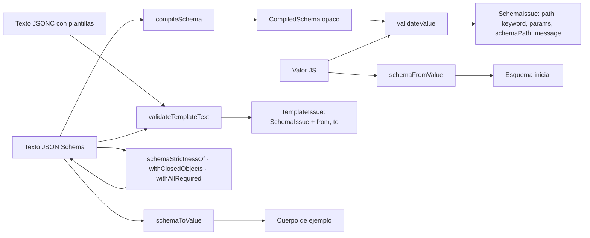

# `@mandor/validate`

Comprueba valores y texto JSON contra JSON Schema completo, ajusta lo estricto de un esquema escribiendo en su propio texto, y va en las dos direcciones entre un cuerpo y su forma: escribe el esquema de un ejemplo y un ejemplo de un esquema. Sirve para mostrar errores de un dato o un borrador sin generar código ni depender de un servicio externo.

## Arquitectura



El validador es [`json-schema-library`](https://github.com/sagold/json-schema-library): recorre el esquema como dato, sin `eval` ni `new Function`, que la CSP de la ventana prohíbe. Lee los drafts 4, 6, 7, 2019-09 y 2020-12; elige por `$schema` y, sin él, lee 2020-12, el dialecto de OpenAPI 3.1. Cubre todas las palabras clave: tipos, `enum`, `const`, límites, `pattern`, `required`, `properties`, `patternProperties`, `additionalProperties`, `unevaluatedProperties`, `propertyNames`, `dependentRequired`, `dependentSchemas`, `prefixItems`, `items`, `contains` con sus cuentas, `unevaluatedItems`, `allOf`, `anyOf`, `oneOf`, `not`, `if`/`then`/`else`, `$ref` y `$defs`. `format` se afirma, no solo se anota: fecha, hora, duración, correo, host, IPv4, IPv6, URI, UUID, puntero JSON y regex.

`compileSchema` analiza JSONC (comentarios y coma final), compila y guarda hasta 32 textos para no repetir el trabajo mientras se edita. Un esquema mal escrito (`type: 5`, una regex rota, un `$ref` a una definición que no existe) es `{ ok: false, message }`, nunca una excepción. `CompiledSchema` muestra solo `source`.

`SchemaIssue` dice dónde está el valor (`path`, puntero dentro del valor; vacío es la raíz), qué regla lo rechazó (`keyword`), qué pidió y qué recibió (`params`, todo texto: `{ expected, received }` en `type`, `{ limit, actual }` en un límite, `{ property }` en `required`…), dónde está la regla dentro del esquema (`schemaPath`; en `required`, la entrada exacta de la clave que falta) y un `message` en inglés para logs. Quien muestra el problema lo redacta desde `keyword` y `params`; este paquete no dibuja mensajes. La tabla de códigos del validador a palabra clave vive en [`src/validate-value/issue-of.ts`](src/validate-value/issue-of.ts) y la de parámetros y mensajes en [`issue-words.ts`](src/validate-value/issue-words.ts).

`validateTemplateText` analiza JSONC y lleva cada `path` a un rango `from`/`to` del texto. Una marca `{{...}}` es valor pendiente y no produce error. Si el texto o el esquema no se pueden analizar, devuelve lista vacía: el diagnóstico de sintaxis es de otro. `rangeOfPointer` hace lo mismo con cualquier puntero en cualquier texto JSONC, y sirve para subrayar una regla dentro del esquema por su `schemaPath`.

Lo estricto de un esquema vive en su texto. `schemaStrictnessOf` lee si sus objetos rechazan claves no declaradas (`closed`) y si todas sus claves son obligatorias (`required`), cada uno `all`, `none` o `some`. `withClosedObjects` escribe o quita `unevaluatedProperties: false` en cada objeto que declara claves (`additionalProperties: false` si `$schema` nombra un draft anterior a 2019-09); nunca en una rama de `allOf`, `anyOf`, `oneOf` o de una condición, ni en una definición a la que una rama se refiere, porque rechazaría las claves de sus hermanas: cierra el objeto que las aplica. `withAllRequired` lista o retira en `required` las claves de `properties`. Los dos editan con `modify` de `jsonc-parser`: conservan comentarios, orden y sangría.

`schemaFromValue` crea un esquema inicial conservador de tipos y forma; no deduce `format` ni `pattern`. `schemaToValue` hace lo contrario con `json-schema-faker`: respeta `format`, `pattern`, `enum` y `examples`, no adivina por el nombre de una propiedad, y un esquema ilegible da `{}`. Cada llamada dibuja un cuerpo distinto; `seed` repite el mismo.

## Uso y cambios

Ejecuta `npm run ci:test -- packages/validate` desde la raíz.

- Una regla nueva del validador llega con la librería; aquí solo entra su código en `KEYWORD_OF_CODE` y, si dice algo más, sus `params` y su mensaje. Prueba un caso rechazado en [`tests/validate-value/`](tests/validate-value/) con su `keyword`, `params` y `schemaPath`.
- Un código que la tabla no conoce sale con el código como `keyword` y el mensaje de la librería.
- Para rangos del editor, [`tests/validate-template/`](tests/validate-template/) y [`tests/text-range/`](tests/text-range/).
- Para lo estricto, [`tests/schema-strictness/`](tests/schema-strictness/): cada caso prueba el texto resultante y que el estado leído después es el pedido.

## API pública

Todas estas exportaciones salen de [`src/index.ts`](src/index.ts):

| Exportación                                                          | Entrada y salida                                                                                                           |
| -------------------------------------------------------------------- | -------------------------------------------------------------------------------------------------------------------------- |
| `compileSchema(source)`                                              | Texto JSON Schema; `{ ok: true, schema }` o `{ ok: false, message }`. El esquema compilado es opaco.                       |
| `validateValue(schema, value)`, `SchemaIssue`                        | Esquema compilado y valor; problemas `{ path, keyword, params, schemaPath, message }`. Lista vacía: el valor cumple.       |
| `validateTemplateText(schemaText, text)`, `TemplateIssue`            | Esquema en texto y cuerpo JSONC; problemas con rango `[from, to)` dentro del cuerpo.                                       |
| `rangeOfPointer(text, pointer)`, `TextRange`                         | Texto JSONC y puntero JSON; el rango del valor que nombra, o nada.                                                         |
| `schemaStrictnessOf(text)`, `SchemaStrictness`, `StrictnessState`    | Texto del esquema; `{ closed, required }`, cada uno `all`, `none` o `some`, o nada si no se lee.                           |
| `withClosedObjects(text, closed)`, `withAllRequired(text, required)` | Texto del esquema; el mismo texto con la regla escrita o quitada. Un texto ilegible vuelve igual.                          |
| `schemaFromValue(value, { required }?)`                              | Texto JSON Schema con tipos y propiedades inferidas del valor. En un arreglo no vacío usa el primer elemento para `items`. |
| `schemaToValue(schema, { seed }?)`                                   | Texto JSON Schema; un cuerpo JSON que lo cumple. Con `seed`, siempre el mismo.                                             |

```ts
import { compileSchema, validateValue } from '@mandor/validate';

const compiled = compileSchema('{"type":"object","required":["id"]}');
if (compiled.ok) {
    const issues = validateValue(compiled.schema, {});
    // [{ path: '', keyword: 'required', params: { property: 'id' },
    //    schemaPath: '/required/0', message: "must have required property 'id'" }]
}
```
