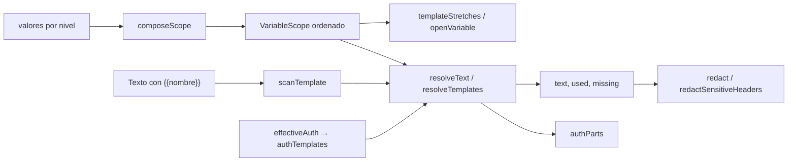

# `@mandor/vars`

Resuelve `{{nombre}}` en texto, reúne variables de varias fuentes, arma la autenticación de una petición y oculta valores secretos. Solo transforma datos que recibe: no abre archivos, sockets ni almacenes de secretos. Depende solo de `@mandor/schema`.

## Arquitectura

Una plantilla contiene marcas `{{nombre}}`. `scanTemplate` separa texto literal y marcas; `resolveText` busca el nombre en un `VariableScope`, sustituye su valor y repite la operación si ese valor contiene más marcas.



`composeScope` fija la precedencia de mayor a menor: `script`, `environment`, `workspace`, `dynamic`, y es el único sitio que conoce ese orden. Quien llama usa `computeDynamicValues` una vez por resolución para generar `$uuid`, `$timestamp` y `$randomInt`; así cada nombre conserva su valor dentro de ese uso. Los valores pueden referirse entre sí.

Nada de la resolución lanza ni bloquea. Un nombre ausente queda escrito como `{{nombre}}` y aparece en `missing` con sus posiciones en el texto original. Un nombre que se repite en su propia cadena, o uno que pasa de diez saltos, también queda escrito: un ciclo en las variables lo ve la persona en lo que sale, nunca como un envío o un dibujo que se rompe.

La resolución informa qué variables se usaron y si alguna era secreta. `redact` sustituye literalmente los valores que recibe; quien resuelve le pasa también lo que produjo a partir de ellos, como un `Basic` en base64, porque buscar solo el valor declarado lo dejaría escapar codificado. `redactSensitiveHeaders` oculta por nombre las cabeceras de credenciales, porque un token escrito a mano no lo declara ninguna variable secreta. `tooShortToHide` dice qué valor es demasiado corto para ocultarlo (menos de 8 caracteres) sin borrar texto que no es secreto. `secretKey` genera una clave estable codificando repo, espacio, entorno y nombre por separado.

La autenticación se resuelve con el resto de la petición. `effectiveAuth` recorre la cadena del nivel más cercano al espacio y toma el primero que declara un esquema; `authTemplates` lo convierte en plantillas `auth:<campo>` que `resolveTemplates` resuelve junto a las de la petición, y `authParts` arma con ellas las cabeceras o la firma. `authHeaderLines` dice qué cabeceras añadirá, para la tabla de cabeceras antes del envío.

`assertSafeAuthority` rechaza una plantilla de URL cuyo host contiene una variable con `/`, `@`, `?` o `#`: después de resolver, `a@evil.test` ya no se distingue de un host escrito a mano. Es la única clase del paquete, `UnsafeAuthorityError`. `pathPlaceholdersOf` y `mapPathPlaceholders` leen y sustituyen los `{nombre}` del path de una URL sin tocar host, query ni fragmento.

Las funciones de presentación no resuelven valores: `templateStretches` clasifica fragmentos con su `TemplateTone` y `openVariable` detecta el nombre incompleto junto al cursor. Revisa [`src/resolution/`](src/resolution/) para el motor, [`src/auth/`](src/auth/) para la autenticación y [`src/redaction/`](src/redaction/) para el ocultamiento. Pruebas: `npm run ci:test -- packages/vars`.

## Uso y cambios

### Resolver una plantilla

Construye el ámbito con `composeScope` y calcula los valores dinámicos una vez para el uso actual. `resolveText` sustituye referencias `{{nombre}}`, sigue referencias entre variables e informa nombres usados y ausentes. `resolveTemplates` hace ese trabajo para varios campos y señala los que tocaron un secreto. Solo el nivel de entorno recibe la lista de nombres secretos.

```ts
import { composeScope, computeDynamicValues, resolveText } from '@mandor/vars';

const scope = composeScope({
    environment: { host: 'example.test' },
    dynamic: computeDynamicValues(),
});
const result = resolveText('wss://{{host}}/events', scope);
// result.text === 'wss://example.test/events'
```

`resolveText` no impide enviar un texto con variables ausentes: revisa `missing` antes de usarlo. Pasa por `redact` lo que vaya a registros o vistas compartibles.

### Cambiar una regla

Empieza en [`src/resolution/`](src/resolution/) y revisa las pruebas de precedencia, ciclos, ausencias, sugerencias y redacción en [`tests/`](tests/). Un esquema de autenticación nuevo se declara en `@mandor/schema` y entra en las tablas de `auth-templates.ts`, `auth-parts.ts` y `auth-header-lines.ts`.

## API pública

Importa desde `@mandor/vars`; [`src/index.ts`](src/index.ts) es su única entrada.

| Exportación                                                               | Contrato                                                                                             |
| ------------------------------------------------------------------------- | ---------------------------------------------------------------------------------------------------- |
| `scanTemplate`, `TemplateSegment`                                         | Separa texto y referencias `{{nombre}}`; `\{{nombre}}` se mantiene literal.                          |
| `composeScope`, `VariableScope`                                           | Construye los cuatro niveles en orden, del más fuerte al más débil.                                  |
| `computeDynamicValues`, `DYNAMIC_NAMES`                                   | Calcula y nombra las tres variables integradas.                                                      |
| `resolveText`                                                             | Sustituye las marcas de un texto; devuelve texto, nombres usados y ausentes. Un ciclo queda literal. |
| `resolveTemplates`                                                        | Resuelve un objeto de campos y devuelve `values`, `used` y `missing` por campo.                      |
| `effectiveAuth`, `authTemplates`, `authParts`, `AuthParts`, `AuthSigning` | El esquema que manda en la cadena, sus plantillas `auth:` y las credenciales resueltas que lleva.    |
| `authHeaderLines`                                                         | Las cabeceras que la autenticación añadirá, tal como las muestra la tabla antes del envío.           |
| `assertSafeAuthority`, `UnsafeAuthorityError`                             | Rechaza una variable que podría mover el host de una URL.                                            |
| `pathPlaceholdersOf`, `mapPathPlaceholders`                               | Los `{nombre}` del path de una URL, una vez cada uno; sustituirlos.                                  |
| `openVariable`                                                            | El nombre que se está escribiendo tras el último `{{` abierto, o `null`.                             |
| `templateStretches`, `TemplateTone`                                       | Fragmentos de una plantilla con el tono que gana cada referencia, para pintar el campo.              |
| `secretKey`                                                               | Clave de almacenamiento de un secreto a partir de cuatro partes codificadas. No almacena el valor.   |
| `tooShortToHide`                                                          | Dice si un valor es demasiado corto para ocultarlo sin borrar texto que no es secreto.               |
| `redact`, `REDACTED`, `redactSensitiveHeaders`                            | Sustituye secretos por el marcador; oculta por nombre las cabeceras sensibles.                       |
| `spellingsToHide`, `redactSpellings`                                      | Grafías de una lista de secretos, calculadas una vez; el reemplazo con ellas en muchos textos.       |
