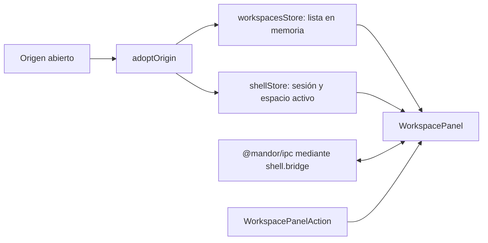

# `@mandor/workspace`

Lista y administra los espacios de trabajo de un origen. Un espacio de trabajo es el ámbito de sus recursos; el origen es el lugar que los contiene. Este paquete presenta la lista, permite crear, renombrar y borrar espacios, y mantiene la lista cargada en memoria. La aplicación decide cómo se abre un origen y qué acciones adicionales ofrece.

## Arquitectura

### Piezas y recorrido

`adoptOrigin(originId, opened)` recibe los espacios del origen abierto, carga la sesión de ese origen y elige el primero si la sesión no selecciona uno presente. La lista vive en `workspacesStore`; el ID del espacio activo vive en `shellStore`, porque forma parte de la sesión. `WorkspacePanel` muestra la lista y conecta diálogos de creación y borrado con el bridge. `WorkspaceTable` y `WorkspaceRow` presentan los datos y la edición del nombre.

## Uso y cambios

### Instalar la lista de espacios

Después de abrir un origen, llama `adoptOrigin(originId, opened)`. Esa función coloca la lista en `workspacesStore` y restaura el espacio activo desde la sesión del shell. La separación importa: la lista describe el origen actual; la selección forma parte de la sesión que se guarda.

Declara la pestaña de administración con `<WorkspacesTabKind />` en el árbol de la app y ábrela con `openWorkspacesTab()`. `WorkspacePanel` conecta la tabla, los diálogos y el bridge. `WorkspaceMenu` proporciona una entrada de navegación. Si necesitas una acción adicional junto al formulario de la página, escribe `<WorkspacePanelAction id="…">` en el árbol de la app; una que crea un espacio junto a la entrada de la página va en `<WorkspaceListAction id="…">`. Las dos viven mientras están montadas. Un espacio que main escribió sin pasar por esta ventana (una importación) se muestra y se abre con `openNewWorkspace(workspaceId)`.

### Recorrido de una operación

[`NewWorkspaceDialog`](src/components/dialog/NewWorkspaceDialog.tsx) solo pide un nombre. El proceso principal calcula el ID y devuelve el espacio creado; `WorkspacePanel` lo agrega a `workspacesStore` y lo activa en el shell. En un renombre, el panel envía el nombre recortado al bridge y actualiza la fila con el valor devuelto. Al borrar, quita el espacio de la lista solo si la operación termina bien.

`adoptOrigin` carga la sesión del origen y conserva el espacio activo si aún existe. Si esa selección ya no está en la lista, activa el primero; si no hay espacios, deja la ventana sin selección. Para cambiar este comportamiento, revisa [`adopt-origin.ts`](src/adopt-origin.ts) y las pruebas de [`tests/`](tests/).

Las operaciones del panel viven en [`src/components/`](src/components/) y cambian [`workspacesStore`](src/workspaces-store.ts) mediante las acciones de [`workspaces.slice.ts`](src/workspaces.slice.ts). Un cambio de contrato también exige revisar el área `workspace` de `@mandor/ipc`.

## API pública

| Exportación                                   | Uso                                                                                    |
| --------------------------------------------- | -------------------------------------------------------------------------------------- |
| `adoptOrigin(originId, opened)`               | Instala lista y sesión de un origen recién abierto. Devuelve `Promise<void>`.          |
| `workspacesStore`                             | Store compartido; `setWorkspaces`, `upsertWorkspace` y `reset` cambian la lista.       |
| `selectWorkspaces(state)`                     | Devuelve la lista con una referencia vacía estable cuando no hay elementos.            |
| `WorkspacePanel`, `WorkspaceMenu`             | Vista de administración y entrada de menú listas para montar.                          |
| `WorkspacesTabKind`                           | Declara en el árbol la pestaña de administración y su superficie.                      |
| `openWorkspacesTab()`                         | Abre o enfoca esa única pestaña en la ventana.                                         |
| `WorkspacePanelAction`, `WorkspaceListAction` | Declaran en el árbol una acción junto al formulario o junto a la entrada de la página. |
| `openNewWorkspace(workspaceId)`               | Relee la lista y abre un espacio que main escribió entero, como una importación.       |

Ejemplo: `<WorkspacePanelAction id="import"><MyAction /></WorkspacePanelAction>`. Desmontarla la retira. Las operaciones de disco pasan por el bridge definido en `@mandor/ipc`.
